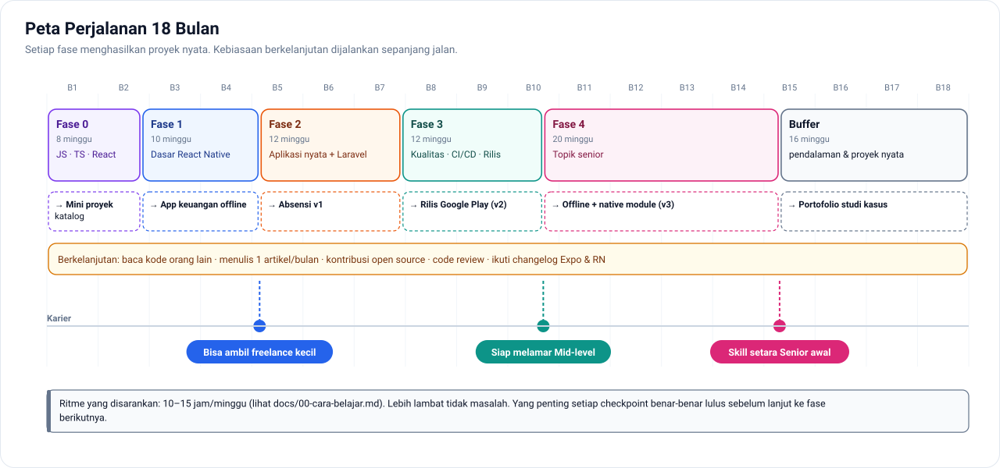

# 🚀 Roadmap Menuju Senior Mobile Developer

> **React Native + TypeScript (Expo)** di sisi mobile, **Laravel** di sisi backend.
> Disusun untuk developer yang sudah menguasai PHP/Laravel dan JavaScript di level menengah.

Target: dalam **±18 bulan** belajar terstruktur (10–15 jam/minggu), punya skill setara **senior awal** mobile developer, plus portofolio aplikasi yang benar-benar dirilis ke Play Store.

---

## 🧭 Kenapa jalur ini?

| Alasan | Penjelasan |
|---|---|
| **JavaScript sudah jadi modal** | Tidak perlu belajar bahasa baru dari nol (Dart/Kotlin/Swift) di awal. |
| **Laravel = keunggulan** | Developer mobile yang bisa merancang API-nya sendiri jauh lebih bernilai. |
| **Ekosistem matang** | Expo menangani build, rilis, dan OTA update. Arsitektur baru React Native sudah stabil. |
| **Satu kode, dua platform** | Android dan iOS dari satu codebase. |

---

## 🗺️ Peta Fase



| Fase | Topik | Durasi | Hasil Akhir |
|---|---|---|---|
| [**Fase 0**](docs/fase-0-javascript-typescript.md) | JavaScript mendalam, TypeScript, React | 8 minggu | Paham *kenapa* kode React berperilaku begitu |
| [**Fase 1**](docs/fase-1-react-native-dasar.md) | Dasar React Native + Expo | 10 minggu | Aplikasi keuangan pribadi (offline) |
| [**Fase 2**](docs/fase-2-aplikasi-nyata-laravel.md) | Aplikasi nyata dengan API Laravel | 12 minggu | Aplikasi absensi v1 (login, GPS, foto, notifikasi) |
| [**Fase 3**](docs/fase-3-kualitas-arsitektur.md) | Arsitektur, testing, CI/CD, rilis | 12 minggu | Aplikasi rilis di Play Store dengan pipeline otomatis |
| [**Fase 4**](docs/fase-4-topik-senior.md) | Performa, animasi, offline-first, native, keamanan | 20 minggu | Offline sync + native module buatan sendiri |
| [**Berkelanjutan**](docs/berkelanjutan.md) | Kebiasaan seorang senior | Sepanjang jalan | Portofolio, tulisan, kontribusi open source |

**Total: ±62 minggu**, ditambah buffer untuk minggu sibuk dan pendalaman, sehingga jadi ±18 bulan.

---

## 📁 Isi Repository

```
roadmap-senior-mobile/
├── README.md                     ← Anda di sini
├── PROGRESS.md                   ← Checklist progres (centang sambil jalan)
├── SUMBER-BELAJAR.md             ← Kumpulan dokumentasi, buku, kursus
│
├── docs/                         ← Materi per fase, dirinci per minggu
│   ├── 00-cara-belajar.md
│   ├── fase-0 … fase-4
│   ├── berkelanjutan.md
│   └── peta-visual.md            ← 🖼️ Galeri semua diagram
│
├── arsitektur/                   ← Blueprint proyek React Native + Laravel
│   ├── 00-dokumen-arsitektur.md  ← ⭐ Mulai dari sini: arsitektur lengkap bergambar
│   ├── 01-struktur-react-native.md
│   ├── 02-struktur-laravel-api.md
│   ├── 03-konvensi-api.md
│   └── 04-alur-autentikasi.md
│
├── proyek-absensi/               ← Desain lengkap proyek portofolio utama
│   ├── 01-prd.md · 02-database.md · 03-api-spec.md
│   └── 04-layar-dan-alur.md · 05-milestone.md
│
├── pendukung/                    ← Referensi cepat
│   ├── glosarium.md · faq-troubleshooting.md
│   ├── cheatsheet-*.md           ← JS/TS · React Native & Expo · Laravel API
│   ├── keputusan-teknologi.md · persiapan-interview.md
│   └── template/                 ← ADR · RFC · post-mortem · PR · checklist rilis · README portofolio
│
├── assets/diagram/               ← 15 diagram SVG
└── tools/diagram/                ← Script Python pembuat diagram
```

### 🧭 Mulai dari mana?

| Saya ingin… | Buka |
|---|---|
| Mulai belajar sekarang | [Cara Belajar](docs/00-cara-belajar.md), lalu [Fase 0](docs/fase-0-javascript-typescript.md) dan repo latihan [js-ts-playground](https://github.com/caesarovera/js-ts-playground) |
| Memahami gambaran besar sistem yang akan dibangun | [Dokumen Arsitektur](arsitektur/00-dokumen-arsitektur.md) |
| Melihat semua diagram sekaligus | [Peta Visual](docs/peta-visual.md) |
| Mencari arti sebuah istilah | [Glosarium](pendukung/glosarium.md) |
| Mengatasi error | [FAQ & Troubleshooting](pendukung/faq-troubleshooting.md) |
| Mencari sintaks / perintah dengan cepat | [Cheat sheet](pendukung/README.md#-referensi-cepat) |
| Bersiap untuk interview | [Persiapan Interview](pendukung/persiapan-interview.md) |

---

## ▶️ Cara Memakai Repo Ini

1. **Baca dulu** [`docs/00-cara-belajar.md`](docs/00-cara-belajar.md): metode belajar, jadwal mingguan, dan setup alat.
2. **Kerjakan fase secara berurutan.** Tiap minggu berisi: 🎯 tujuan, 📚 materi, 🛠 latihan, dan ✅ checkpoint.
3. **Centang progres** di [`PROGRESS.md`](PROGRESS.md) setiap selesai satu minggu.
4. **Simpan semua latihan di GitHub**, satu repo per proyek. Itu akan menjadi portofolio Anda.
5. **Jangan lompat checkpoint.** Kalau belum bisa menjawab pertanyaan checkpoint, ulangi minggu itu.

---

## 🎯 Definisi "Senior Awal" yang Dipakai di Sini

Senior **bukan** soal banyaknya library yang dihafal. Seorang senior mobile developer bisa:

1. **Merancang arsitektur** yang tetap rapi saat aplikasi sudah punya puluhan fitur
2. **Mendiagnosis masalah performa**: list lag, memory leak, startup lambat
3. **Menangani kasus sulit** seperti offline-first, sinkronisasi data, dan background task
4. **Turun ke native** (Kotlin/Swift) saat library yang ada tidak cukup
5. **Mengelola rilis**: CI/CD, versioning, crash monitoring, rollback
6. **Mengambil keputusan teknis** dan menjelaskan trade-off-nya ke tim

Setiap fase dirancang untuk membangun satu atau lebih kemampuan di atas.

---

## 🧱 Tech Stack

**Mobile:** React Native · Expo · TypeScript · Expo Router · TanStack Query · Zustand · React Hook Form · Zod · MMKV · Reanimated · FlashList · expo-sqlite

**Backend:** Laravel · Sanctum · Reverb · Queue · Pest

**Kualitas & Rilis:** Jest · React Native Testing Library · Maestro · GitHub Actions · EAS Build/Submit/Update · Sentry

---

> 💡 **Catatan realistis:** roadmap ini membawa *skill* Anda ke level senior awal. *Pengakuan* sebagai senior biasanya datang dari pengalaman produksi: menangani bug pengguna nyata, rilis yang gagal, dan refactor besar. Usahakan secepatnya punya aplikasi yang **dipakai orang**.
