# 00 — Dokumen Arsitektur: Aplikasi Absensi

[← Kembali ke README](../README.md) · [Galeri semua diagram](../docs/peta-visual.md)

> Dokumen ini adalah **pintu masuk** untuk memahami seluruh arsitektur proyek portofolio. Bacalah dari atas ke bawah. Setiap bagian merangkum satu topik, menampilkan diagramnya, lalu menautkan ke dokumen rinci.

| | |
|---|---|
| **Sistem** | Aplikasi absensi karyawan (mobile) + backend & panel admin |
| **Stack** | React Native (Expo) + TypeScript · Laravel · MySQL/PostgreSQL · Redis |
| **Versi** | v1 (Fase 2) → v2 (Fase 3) → v3 (Fase 4) |
| **Pembaca** | Anda sendiri sambil belajar, reviewer portofolio, dan calon rekan tim |

---

## Daftar Isi

1. [Tujuan & Batasan](#1-tujuan--batasan)
2. [Gambaran Sistem](#2-gambaran-sistem)
3. [Arsitektur Aplikasi Mobile](#3-arsitektur-aplikasi-mobile)
4. [Arsitektur Backend Laravel](#4-arsitektur-backend-laravel)
5. [Data](#5-data)
6. [Alur-Alur Utama](#6-alur-alur-utama)
7. [Kualitas: Testing & Rilis](#7-kualitas-testing--rilis)
8. [Atribut Kualitas](#8-atribut-kualitas-performa-keamanan-keandalan)
9. [Keputusan Arsitektur (ADR)](#9-keputusan-arsitektur-adr)
10. [Risiko & Mitigasi](#10-risiko--mitigasi)
11. [Urutan Membaca untuk Belajar](#11-urutan-membaca-untuk-belajar)

---

## 1. Tujuan & Batasan

### Tujuan arsitektur
| Tujuan | Diwujudkan oleh |
|---|---|
| **Absen cepat** (< 15 detik) | Data hari ini di-cache (TanStack Query), foto dikompres sebelum upload |
| **Sulit dicurangi** | Geofence & waktu dihitung di **server**; deteksi fake GPS (v3) |
| **Andal di sinyal lemah** | Timeout + retry, cache persisten, pola outbox offline (v3) |
| **Mudah dikembangkan tim** | Struktur berbasis fitur, kontrak API tertulis, test otomatis, CI |
| **Aman dirilis** | Varian dev/preview/production, OTA dengan `runtimeVersion`, staged rollout, Sentry |

### Batasan
- **Satu codebase** untuk Android & iOS (prioritas Android).
- Aplikasi versi lama tetap beredar bertahun-tahun, jadi **API harus berversi** (`/api/v1`).
- Tidak ada pelacakan lokasi di background (privasi + kebijakan Play Store).
- Tim kecil (Anda sendiri), sehingga pilih layanan yang mengurangi beban operasional (Expo EAS, Filament).

---

## 2. Gambaran Sistem

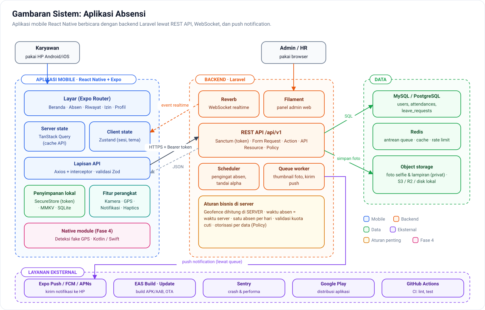

| Komponen | Tanggung jawab | Teknologi |
|---|---|---|
| **Aplikasi mobile** | UI karyawan, ambil lokasi & selfie, cache data, antrean offline | React Native, Expo, TypeScript |
| **REST API** | Autentikasi, validasi, aturan bisnis, otorisasi | Laravel, Sanctum |
| **Queue worker** | Pekerjaan lambat: thumbnail foto, kirim push | Laravel Queue + Redis |
| **Reverb** | Kirim event realtime ke aplikasi yang sedang terbuka | Laravel Reverb (WebSocket) |
| **Scheduler** | Tugas terjadwal: pengingat absen, tandai alpha, bersihkan token | Laravel Scheduler |
| **Panel admin** | Kelola karyawan/kantor/shift, setujui izin, laporan | Filament |
| **Database** | Data utama | MySQL / PostgreSQL |
| **Object storage** | Foto selfie & lampiran (privat) | S3 / Cloudflare R2 / disk lokal |
| **Layanan eksternal** | Push (Expo/FCM/APNs), build & OTA (EAS), crash (Sentry), distribusi (Play) | |

**Prinsip utama: aplikasi mobile tidak bisa dipercaya.** Semua yang menentukan sah atau tidaknya absensi (jarak, waktu, duplikasi, hak akses) diputuskan di server.

---

## 3. Arsitektur Aplikasi Mobile

### 3.1 Struktur berbasis fitur & berlapis

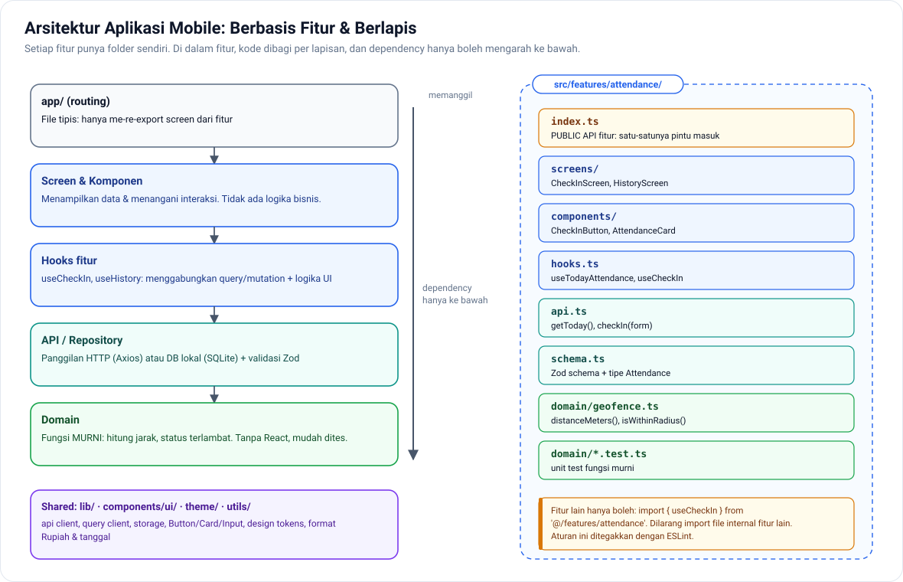

- **`app/`** hanya berisi routing (Expo Router). File di sini tipis.
- **`src/features/<fitur>/`** memuat semua kode satu fitur. Fitur lain hanya boleh meng-import lewat `index.ts`.
- **Dependency hanya mengarah ke bawah:** Screen → Hooks → API/Repository → Domain.
- **Domain** berisi fungsi murni (misalnya `distanceMeters`). Karena tanpa React, bagian inilah yang paling mudah dan paling bernilai untuk dites.

➡️ Rinci: [01 — Struktur & Arsitektur React Native](01-struktur-react-native.md)

### 3.2 Di mana menyimpan data?

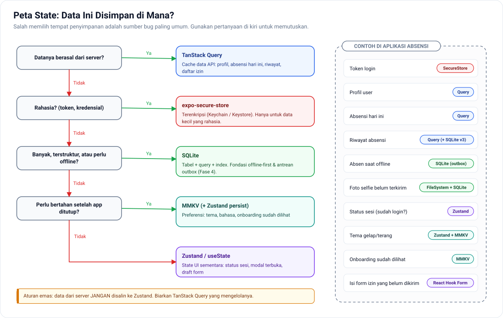

Kesalahan paling umum developer React: **menyalin data server ke state global**. Di arsitektur ini:
- **Server state** → TanStack Query (cache, refetch, invalidasi otomatis)
- **Client state** → Zustand (hanya status sesi & preferensi)
- **Rahasia** → SecureStore
- **Data offline / besar** → SQLite

### 3.3 Siklus cache TanStack Query

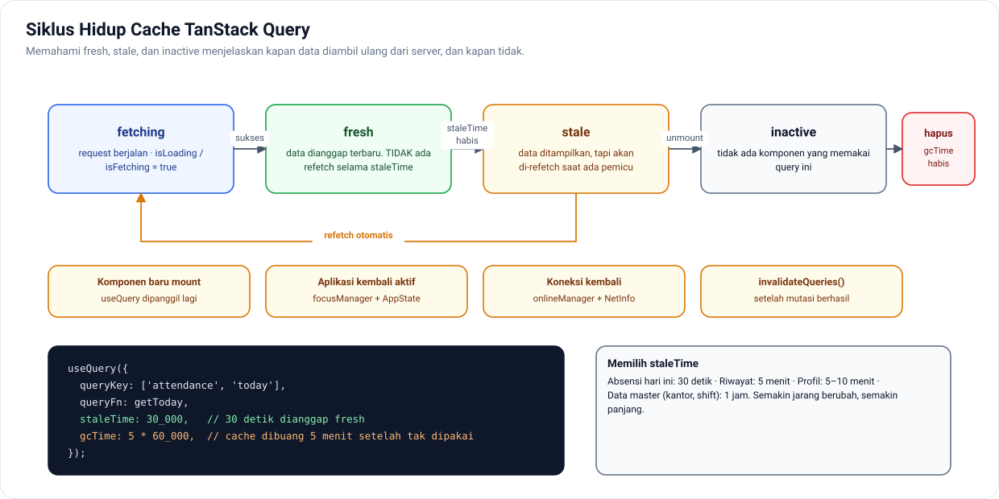

Pahami `staleTime` (berapa lama data dianggap segar) dan `gcTime` (berapa lama cache disimpan setelah tidak dipakai). Kedua angka ini menentukan seberapa sering aplikasi memanggil API.

### 3.4 Cara kerja React Native di balik layar

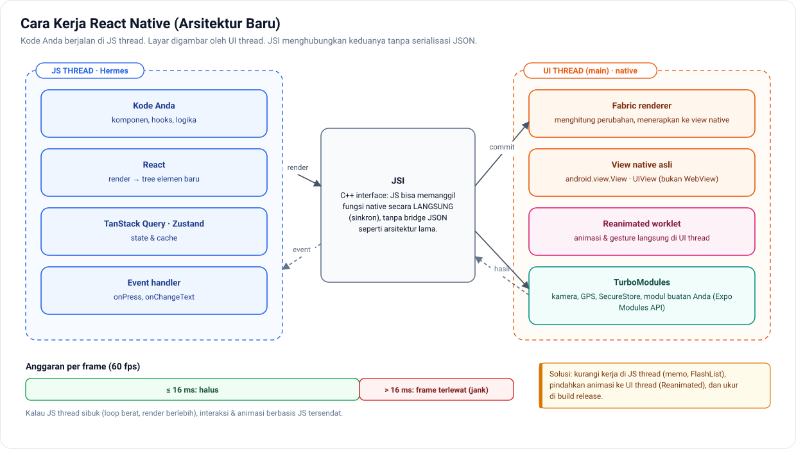

Kode Anda berjalan di **JS thread**, sedangkan layar digambar oleh **UI thread**. Kalau JS thread sibuk lebih dari ~16 ms, frame terlewat dan UI terasa patah. Ini dasar semua optimasi performa di Fase 4.

---

## 4. Arsitektur Backend Laravel

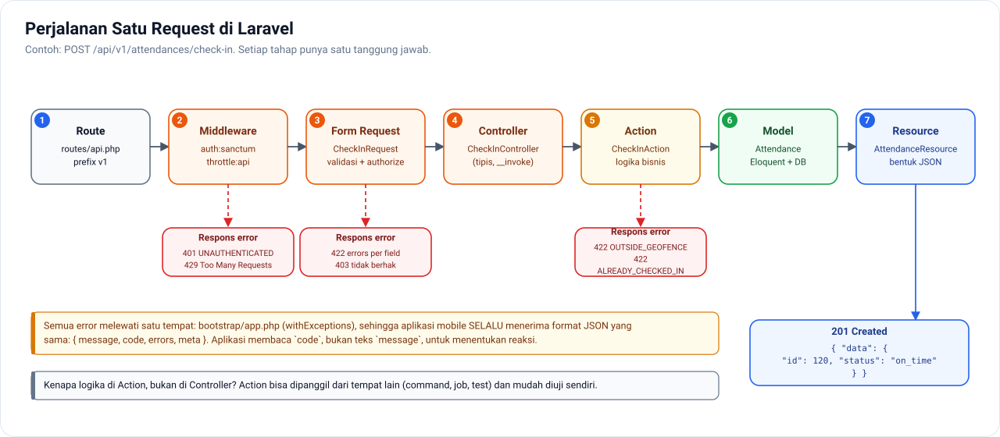

| Lapisan | File contoh | Aturan |
|---|---|---|
| Route | `routes/api.php` | Selalu di bawah prefix `v1` |
| Middleware | `auth:sanctum`, `throttle` | Autentikasi & rate limit |
| Form Request | `CheckInRequest` | Validasi + `authorize()` |
| Controller | `CheckInController` | **Tipis**: terima → delegasikan → kembalikan |
| Action | `CheckInAction` | **Logika bisnis** di sini, bisa dipakai ulang & dites |
| Model | `Attendance` | Eloquent, cast enum, relasi |
| Resource | `AttendanceResource` | Bentuk JSON; **jangan pernah me-return model mentah** |
| Exception handler | `bootstrap/app.php` | Satu format error untuk semua endpoint |

➡️ Rinci: [02 — Struktur Laravel API](02-struktur-laravel-api.md) · [03 — Konvensi API](03-konvensi-api.md)

---

## 5. Data

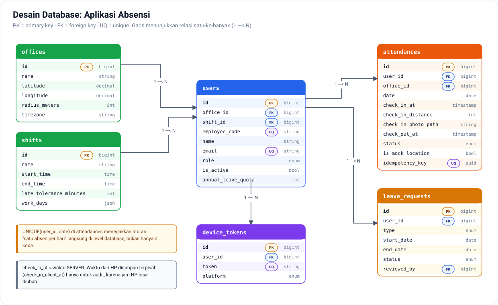

Keputusan penting:
- **`UNIQUE(user_id, date)`** di `attendances`: aturan "satu absen per hari" ditegakkan oleh database, bukan hanya oleh kode.
- **Dua kolom waktu**: `check_in_at` (server, yang berlaku) dan `check_in_client_at` (HP, untuk audit).
- **`idempotency_key`** (v3): mencegah data ganda saat request dikirim ulang.
- **`device_tokens`** terpisah dari `users`: satu user bisa punya banyak HP.

➡️ Rinci: [Desain Database](../proyek-absensi/02-database.md)

---

## 6. Alur-Alur Utama

### 6.1 Autentikasi

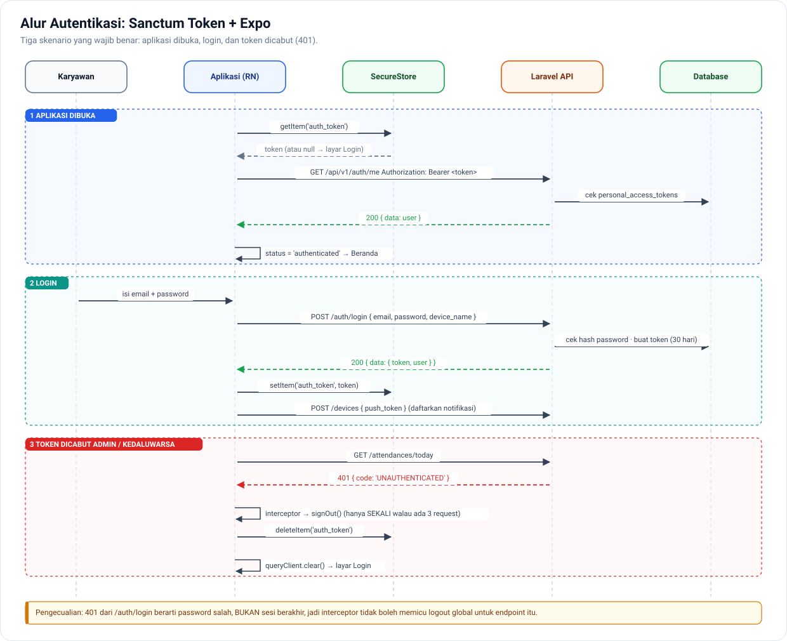

➡️ Rinci + kode: [04 — Alur Autentikasi](04-alur-autentikasi.md)

### 6.2 Absen masuk (check-in)

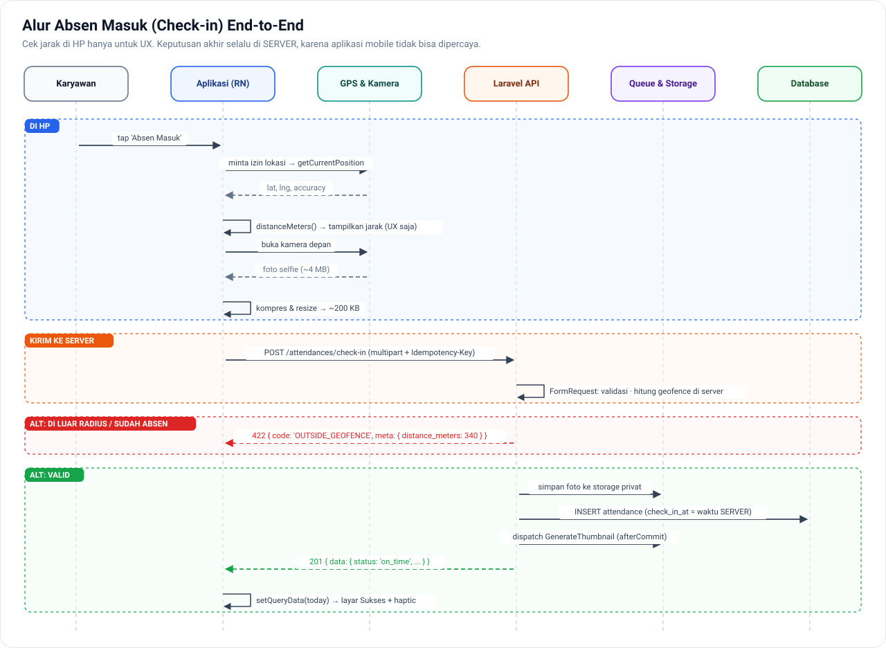

Perhatikan pembagian peran: HP menghitung jarak **hanya untuk UX** (memberi tahu user lebih awal), sedangkan **server** yang memutuskan.

➡️ Rinci: [Spesifikasi API](../proyek-absensi/03-api-spec.md) · [Layar & Alur](../proyek-absensi/04-layar-dan-alur.md)

### 6.3 Push notification vs realtime

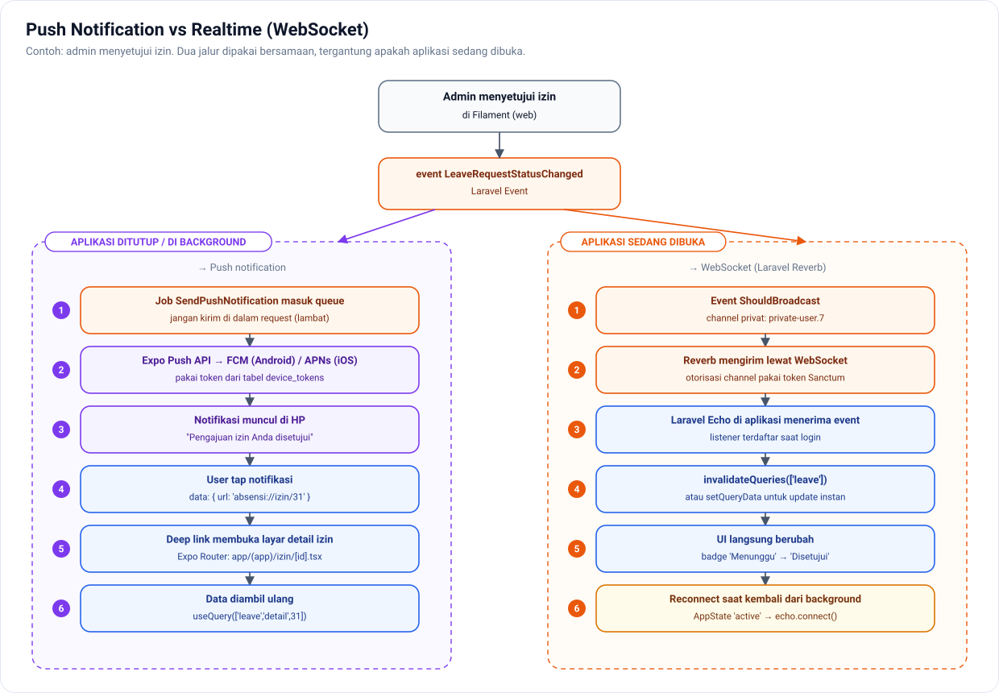

| Kondisi aplikasi | Mekanisme | Contoh |
|---|---|---|
| Tertutup / background | **Push notification** (Expo Push → FCM/APNs) | "Izin Anda disetujui" muncul di lock screen |
| Sedang dibuka | **WebSocket** (Reverb + Echo) | Status di layar langsung berubah tanpa refresh |

### 6.4 Offline-first (v3, Fase 4)

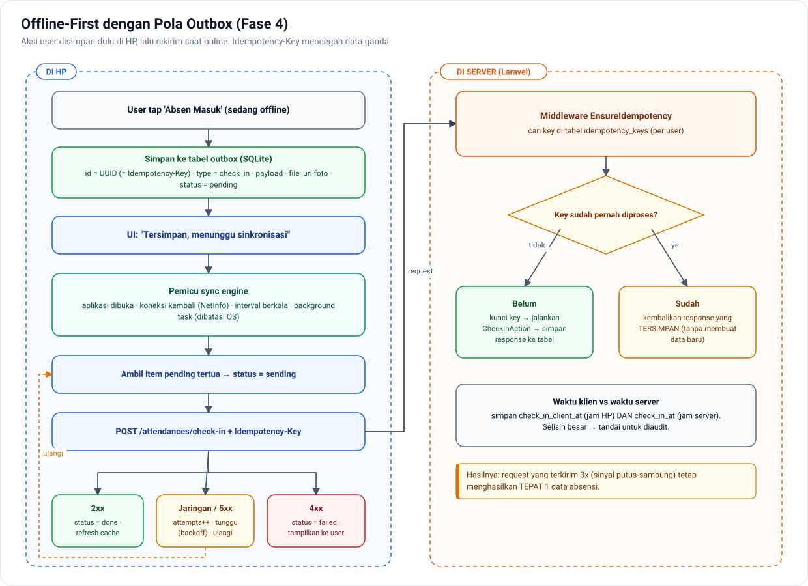

Dua kunci: **outbox** di HP (aksi disimpan dulu, dikirim nanti) dan **idempotency key** di server (request ganda tetap menghasilkan satu data).

---

## 7. Kualitas: Testing & Rilis

### 7.1 Strategi testing

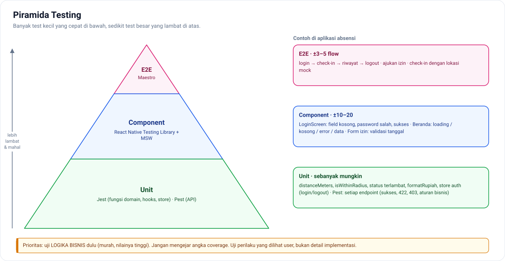

### 7.2 Alur rilis

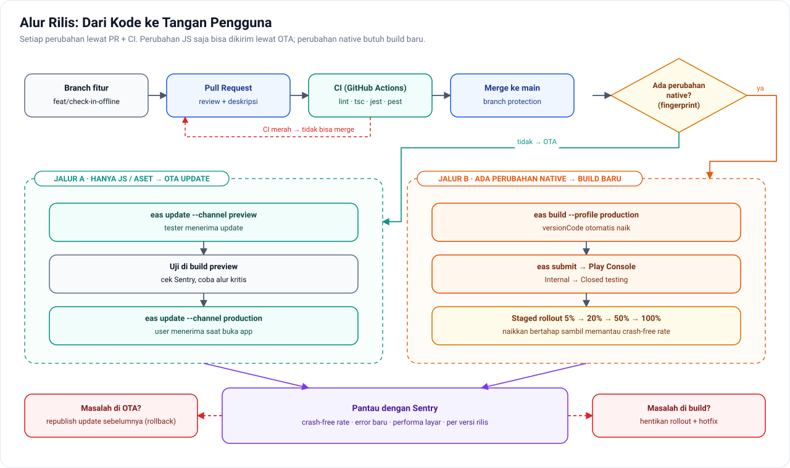

| Jenis perubahan | Cara rilis | Waktu sampai ke user |
|---|---|---|
| Teks, logika JS, style, gambar | **OTA** (`eas update`) | Menit, saat aplikasi dibuka berikutnya |
| Library native baru, izin baru, versi SDK | **Build baru** (`eas build` + `eas submit`) | Jam sampai hari (review store) |

➡️ Rinci: [Fase 3](../docs/fase-3-kualitas-arsitektur.md) · [Checklist rilis](../pendukung/template/checklist-rilis.md)

---

## 8. Atribut Kualitas (Performa, Keamanan, Keandalan)

| Atribut | Target | Cara mencapai | Cara mengukur |
|---|---|---|---|
| **Performa: startup** | < 2 detik (cold start, HP menengah) | Lazy load, provider minimal, Hermes | Stopwatch di build release, Sentry |
| **Performa: scroll** | 60 fps untuk 10.000 data | FlashList, thumbnail, item ringan | Perf Monitor, React Profiler |
| **Ukuran upload** | < 300 KB per foto | `expo-image-manipulator` | Log ukuran sebelum upload |
| **Keamanan: token** | Tidak bisa dibaca aplikasi lain | SecureStore, masa berlaku 30 hari | Review kode, self-pentest |
| **Keamanan: data** | Tidak ada IDOR | Policy di setiap endpoint | Test Pest otorisasi |
| **Keamanan: kecurangan** | Fake GPS terdeteksi | Native module + flag ke server | Uji dengan aplikasi mock location |
| **Keandalan** | Absen tidak hilang / ganda | Outbox + idempotency | Matriks 10 skenario offline |
| **Observabilitas** | Crash diketahui < 1 jam | Sentry + alert email | Crash-free rate per rilis |

---

## 9. Keputusan Arsitektur (ADR)

| # | Keputusan | Alternatif yang ditolak | Alasan |
|---|---|---|---|
| 0001 | React Native + Expo | Flutter, native, KMP | Memanfaatkan skill JS; satu codebase; EAS mengurangi beban build |
| 0002 | TanStack Query untuk server state | Redux, fetch manual | Cache/refetch/invalidasi otomatis; kode lebih sedikit |
| 0003 | Zustand untuk client state | Redux Toolkit, Context | Ringan, selector mencegah re-render |
| 0004 | Struktur berbasis fitur | Berbasis jenis file | Perubahan terlokalisasi |
| 0005 | Token Sanctum di SecureStore | Cookie session, AsyncStorage | Mobile tidak cocok cookie; AsyncStorage tidak terenkripsi |
| 0006 | Validasi response dengan Zod | Percaya tipe TS saja | Kontrak API yang berubah langsung terdeteksi |
| 0007 | Geofence & waktu di server | Validasi di HP saja | HP bisa dimanipulasi |
| 0008 | `snake_case` di seluruh API & tipe TS | Konversi ke camelCase | Tanpa lapisan konversi; konsisten dengan Laravel |
| 0009 | Outbox + idempotency untuk offline | WatermelonDB sync | Kontrol penuh, cocok untuk data append-only |
| 0010 | OTA untuk perubahan JS saja | Selalu build baru | Perbaikan bug dalam hitungan menit |

Tulis setiap keputusan sebagai file ADR memakai [template ADR](../pendukung/template/adr.md). Perbandingan teknologi yang lebih rinci ada di [Keputusan Teknologi](../pendukung/keputusan-teknologi.md).

---

## 10. Risiko & Mitigasi

| Risiko | Dampak | Kemungkinan | Mitigasi |
|---|---|---|---|
| Karyawan memakai fake GPS | Tinggi | Sedang | Deteksi mock location (v3), selfie, audit selisih waktu |
| Sinyal hilang saat absen | Sedang | Tinggi | Retry + outbox offline (v3) |
| Token bocor | Tinggi | Rendah | SecureStore, masa berlaku, cabut per device |
| Perubahan API merusak aplikasi lama | Tinggi | Sedang | Versioning `/v1`, test kontrak (Pest `assertJsonStructure`), Zod di klien |
| OTA berisi bug | Sedang | Sedang | Channel preview dulu, Sentry, rollback |
| Bundle OTA tidak cocok dengan kode native | Tinggi | Rendah | `runtimeVersion` policy `fingerprint` |
| Keystore Android hilang | Sangat tinggi | Rendah | Dikelola EAS + backup terpisah |
| Kebijakan Play Store (izin lokasi, data safety) | Sedang | Sedang | Lokasi hanya foreground, formulir Data Safety jujur, kebijakan privasi |

---

## 11. Urutan Membaca untuk Belajar

| Saat Anda di… | Baca bagian | Lalu dokumen rinci |
|---|---|---|
| Fase 0 | [Event loop](../assets/diagram/event-loop.svg) | [Fase 0](../docs/fase-0-javascript-typescript.md) |
| Fase 1 | 3.4 (thread RN), 3.2 (peta state) | [Fase 1](../docs/fase-1-react-native-dasar.md) |
| Fase 2 | 2, 3, 4, 5, 6.1–6.3 | [01](01-struktur-react-native.md) · [02](02-struktur-laravel-api.md) · [03](03-konvensi-api.md) · [04](04-alur-autentikasi.md) · [Proyek Absensi](../proyek-absensi/01-prd.md) |
| Fase 3 | 3.1, 7, 9 | [Fase 3](../docs/fase-3-kualitas-arsitektur.md) · [Template](../pendukung/template/) |
| Fase 4 | 3.4, 6.4, 8, 10 | [Fase 4](../docs/fase-4-topik-senior.md) |

> 💡 **Latihan seorang senior:** setelah selesai Fase 3, coba gambar ulang diagram "Gambaran Sistem" **dari ingatan**, lalu bandingkan. Bagian yang terlupa adalah bagian yang perlu dipelajari ulang.
