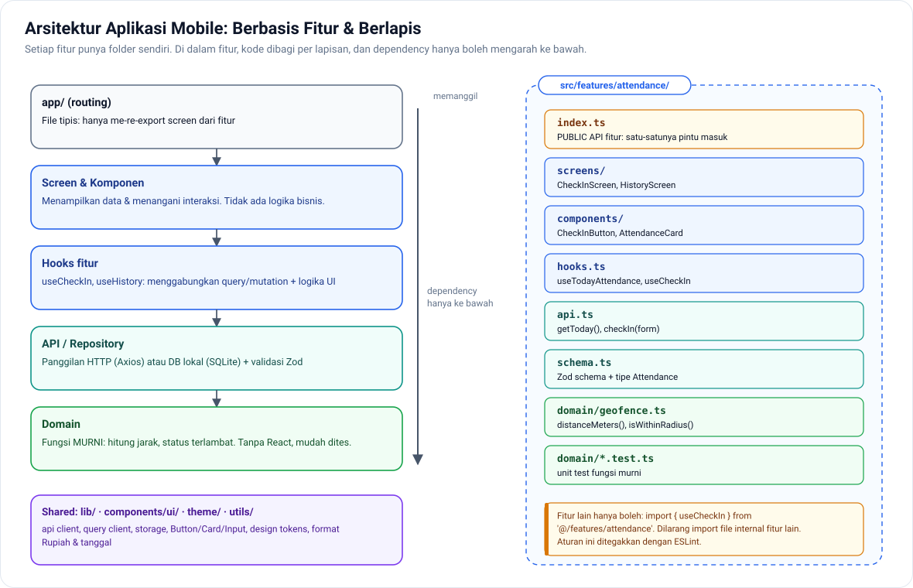

# 01 — Struktur & Arsitektur Proyek React Native

[← Kembali ke README](../README.md)

Blueprint untuk `absensi-mobile`. Mulai dipakai di **Fase 2**, lalu disempurnakan di **Fase 3**.

---

## 1. Membuat Proyek

```bash
npx create-expo-app@latest absensi-mobile
```

```bash
cd absensi-mobile && npx expo install expo-router expo-secure-store expo-splash-screen expo-location expo-camera expo-image-manipulator expo-notifications @react-native-community/netinfo react-native-mmkv
```

```bash
npm install @tanstack/react-query zustand axios zod react-hook-form @hookform/resolvers
```

> Selalu pakai `npx expo install` untuk library native supaya versinya cocok dengan SDK Expo yang dipakai.

---

## 2. Struktur Folder (Feature-Based)



```
absensi-mobile/
├── app/                              ← HANYA routing (Expo Router). File di sini tipis.
│   ├── _layout.tsx                   ← Root: providers + guard auth
│   ├── (auth)/
│   │   ├── _layout.tsx
│   │   └── login.tsx                 → export { LoginScreen as default } from '@/features/auth'
│   └── (app)/
│       ├── _layout.tsx               ← Stack
│       ├── (tabs)/
│       │   ├── _layout.tsx           ← Bottom tabs
│       │   ├── index.tsx             ← Beranda
│       │   ├── riwayat.tsx
│       │   ├── izin.tsx
│       │   └── profil.tsx
│       ├── absen/                    ← lokasi.tsx, selfie.tsx, sukses.tsx
│       ├── riwayat/[id].tsx
│       └── izin/
│           ├── [id].tsx
│           └── baru.tsx              ← modal
│   (struktur lengkap: proyek-absensi/04-layar-dan-alur.md)
│
├── src/
│   ├── features/                     ← Satu folder per fitur
│   │   ├── auth/
│   │   │   ├── api.ts                ← Panggilan HTTP
│   │   │   ├── hooks.ts              ← useLogin, useLogout, useMe
│   │   │   ├── store.ts              ← Zustand: status auth
│   │   │   ├── schema.ts             ← Zod schema + tipe
│   │   │   ├── screens/
│   │   │   │   └── LoginScreen.tsx
│   │   │   ├── components/
│   │   │   └── index.ts              ← PUBLIC API fitur (hanya ini yang boleh di-import dari luar)
│   │   ├── attendance/
│   │   │   ├── api.ts
│   │   │   ├── hooks.ts              ← useTodayAttendance, useCheckIn, useHistory
│   │   │   ├── schema.ts
│   │   │   ├── domain/               ← Logika murni, tanpa React (mudah dites)
│   │   │   │   ├── geofence.ts
│   │   │   │   ├── geofence.test.ts
│   │   │   │   ├── status.ts
│   │   │   │   └── status.test.ts
│   │   │   ├── screens/
│   │   │   ├── components/
│   │   │   └── index.ts
│   │   ├── leave/                    ← Izin & cuti
│   │   ├── notifications/
│   │   └── profile/
│   │
│   ├── components/ui/                ← Komponen UI generik: Button, Card, Input, Screen, EmptyState
│   ├── lib/                          ← Infrastruktur yang dipakai bersama
│   │   ├── api/
│   │   │   ├── client.ts             ← Axios instance + interceptor
│   │   │   ├── errors.ts             ← ApiError + normalisasi error
│   │   │   └── query-client.ts
│   │   ├── storage/
│   │   │   ├── token.ts              ← SecureStore + cache memori
│   │   │   └── mmkv.ts
│   │   └── query-keys.ts             ← Query key factory
│   ├── config/
│   │   └── env.ts                    ← Validasi env dengan Zod
│   ├── theme/                        ← Design tokens
│   └── utils/                        ← Format tanggal, Rupiah, dan sebagainya
│
├── docs/
│   └── adr/                          ← Architecture Decision Records
├── .maestro/                         ← E2E test
├── app.config.ts
├── eas.json
└── tsconfig.json
```

### Aturan Dependency

```
app/ (routing)  ──►  features/*/index.ts  ──►  components/ui, lib, utils, theme
                         │
                         ✗  features/attendance TIDAK BOLEH import features/leave/hooks.ts secara langsung
                         ✓  boleh: import { useMe } from '@/features/auth'
```

- `domain/` **tidak boleh** meng-import React, Expo, atau `lib/api`. Isinya fungsi murni.
- `components/ui/` **tidak boleh** tahu soal fitur atau API.
- Tegakkan dengan ESLint (`eslint-plugin-boundaries` atau `import/no-restricted-paths`) di Fase 3.

### `tsconfig.json`

```json
{
  "extends": "expo/tsconfig.base",
  "compilerOptions": {
    "strict": true,
    "noUncheckedIndexedAccess": true,
    "paths": { "@/*": ["./src/*"] }
  }
}
```

---

## 3. Kode Inti

### `src/config/env.ts`: validasi environment saat aplikasi start

```ts
import { z } from 'zod';

const EnvSchema = z.object({
  EXPO_PUBLIC_API_URL: z.string().url(),
  EXPO_PUBLIC_APP_VARIANT: z.enum(['development', 'preview', 'production']).default('development'),
});

const parsed = EnvSchema.safeParse({
  EXPO_PUBLIC_API_URL: process.env.EXPO_PUBLIC_API_URL,
  EXPO_PUBLIC_APP_VARIANT: process.env.EXPO_PUBLIC_APP_VARIANT,
});

if (!parsed.success) {
  throw new Error(`Env tidak valid: ${parsed.error.message}`);
}

export const env = {
  API_URL: parsed.data.EXPO_PUBLIC_API_URL,
  VARIANT: parsed.data.EXPO_PUBLIC_APP_VARIANT,
};
```

> Catatan: Expo hanya meng-inline `process.env.EXPO_PUBLIC_*` yang ditulis **lengkap** seperti di atas (bukan `process.env[key]`).

### `src/lib/storage/token.ts`: SecureStore + cache memori

```ts
import * as SecureStore from 'expo-secure-store';

const KEY = 'auth_token';
let cached: string | null | undefined; // undefined = belum dibaca

export const tokenStorage = {
  async get(): Promise<string | null> {
    if (cached === undefined) cached = await SecureStore.getItemAsync(KEY);
    return cached;
  },
  async set(token: string) {
    cached = token;
    await SecureStore.setItemAsync(KEY, token);
  },
  async clear() {
    cached = null;
    await SecureStore.deleteItemAsync(KEY);
  },
};
```

Cache memori mencegah SecureStore (yang relatif lambat) dibaca di **setiap** request.

### `src/lib/api/errors.ts`: satu bentuk error untuk seluruh aplikasi

```ts
import { isAxiosError } from 'axios';

export class ApiError extends Error {
  constructor(
    message: string,
    public status: number | null,           // null = jaringan / timeout
    public code: string | null = null,      // kode bisnis dari server, misal 'OUTSIDE_GEOFENCE'
    public fieldErrors: Record<string, string[]> = {},
  ) {
    super(message);
  }
  get isNetworkError() { return this.status === null; }
  get isValidationError() { return this.status === 422; }
}

export function toApiError(error: unknown): ApiError {
  if (error instanceof ApiError) return error;
  if (isAxiosError(error)) {
    if (!error.response) {
      return new ApiError('Tidak ada koneksi internet atau server tidak merespons.', null);
    }
    const body = error.response.data as { message?: string; code?: string; errors?: Record<string, string[]> };
    return new ApiError(
      body?.message ?? 'Terjadi kesalahan.',
      error.response.status,
      body?.code ?? null,
      body?.errors ?? {},
    );
  }
  return new ApiError('Terjadi kesalahan tak terduga.', null);
}
```

### `src/lib/api/client.ts`: Axios instance

```ts
import axios from 'axios';
import { Platform } from 'react-native';
import * as Application from 'expo-application';
import { env } from '@/config/env';
import { tokenStorage } from '@/lib/storage/token';
import { toApiError } from './errors';

export const api = axios.create({
  baseURL: `${env.API_URL}/api/v1`,
  timeout: 15_000,
  headers: {
    Accept: 'application/json',
    'X-Platform': Platform.OS,
    'X-App-Version': Application.nativeApplicationVersion ?? 'unknown',
  },
});

// Diisi oleh store auth, supaya tidak terjadi circular import
let unauthorizedHandler: (() => void) | null = null;
export function setUnauthorizedHandler(fn: () => void) {
  unauthorizedHandler = fn;
}

api.interceptors.request.use(async (config) => {
  const token = await tokenStorage.get();
  if (token) config.headers.Authorization = `Bearer ${token}`;
  return config;
});

api.interceptors.response.use(
  (response) => response,
  (error) => {
    const apiError = toApiError(error);
    // 401 dari /auth/login = kredensial salah, BUKAN sesi berakhir
    const isLoginRequest = error.config?.url?.includes('/auth/login');
    if (apiError.status === 401 && !isLoginRequest) unauthorizedHandler?.();
    return Promise.reject(apiError);
  },
);
```

### `src/lib/api/query-client.ts`

```ts
import { QueryClient, focusManager, onlineManager } from '@tanstack/react-query';
import NetInfo from '@react-native-community/netinfo';
import { AppState, Platform } from 'react-native';
import { ApiError } from './errors';

// Refetch saat aplikasi kembali ke foreground
AppState.addEventListener('change', (status) => {
  if (Platform.OS !== 'web') focusManager.setFocused(status === 'active');
});

// Beri tahu React Query status koneksi
onlineManager.setEventListener((setOnline) =>
  NetInfo.addEventListener((state) => setOnline(!!state.isConnected)),
);

export const queryClient = new QueryClient({
  defaultOptions: {
    queries: {
      staleTime: 60_000,
      retry: (failureCount, error) => {
        // Jangan retry error 4xx: hasilnya pasti sama
        if (error instanceof ApiError && error.status && error.status < 500) return false;
        return failureCount < 2;
      },
    },
  },
});
```

### `src/lib/query-keys.ts`: Query Key Factory

```ts
export const queryKeys = {
  me: ['me'] as const,
  attendance: {
    all: ['attendance'] as const,
    today: () => [...queryKeys.attendance.all, 'today'] as const,
    history: (filters: { month?: string } = {}) => [...queryKeys.attendance.all, 'history', filters] as const,
    detail: (id: number) => [...queryKeys.attendance.all, 'detail', id] as const,
  },
  leave: {
    all: ['leave'] as const,
    list: (status?: string) => [...queryKeys.leave.all, 'list', status] as const,
    detail: (id: number) => [...queryKeys.leave.all, 'detail', id] as const,
  },
};

// invalidateQueries({ queryKey: queryKeys.attendance.all }) → membatalkan cache SEMUA data absensi
```

### `src/features/auth/store.ts`: Zustand

```ts
import { create } from 'zustand';
import { tokenStorage } from '@/lib/storage/token';
import { setUnauthorizedHandler } from '@/lib/api/client';
import { queryClient } from '@/lib/api/query-client';

type AuthStatus = 'checking' | 'authenticated' | 'unauthenticated';

type AuthState = {
  status: AuthStatus;
  bootstrap: () => Promise<void>;
  signIn: (token: string) => Promise<void>;
  signOut: () => Promise<void>;
};

export const useAuthStore = create<AuthState>((set, get) => ({
  status: 'checking',

  bootstrap: async () => {
    const token = await tokenStorage.get();
    set({ status: token ? 'authenticated' : 'unauthenticated' });
  },

  signIn: async (token) => {
    await tokenStorage.set(token);
    set({ status: 'authenticated' });
  },

  signOut: async () => {
    if (get().status === 'unauthenticated') return; // idempoten: 3x 401 = 1x logout
    set({ status: 'unauthenticated' });
    await tokenStorage.clear();
    queryClient.clear(); // jangan sampai data user lama terlihat oleh user berikutnya
  },
}));

setUnauthorizedHandler(() => {
  void useAuthStore.getState().signOut();
});
```

> Perhatikan: **data user (profil) tidak disimpan di store**. Data itu server state, jadi tempatnya di `useMe()` (TanStack Query). Store hanya menyimpan *status* sesi.

### `app/_layout.tsx`: Root layout + guard

```tsx
import { useEffect } from 'react';
import { Stack } from 'expo-router';
import * as SplashScreen from 'expo-splash-screen';
import { QueryClientProvider } from '@tanstack/react-query';
import { queryClient } from '@/lib/api/query-client';
import { useAuthStore } from '@/features/auth';

SplashScreen.preventAutoHideAsync();

export default function RootLayout() {
  const status = useAuthStore((s) => s.status);

  useEffect(() => {
    void useAuthStore.getState().bootstrap();
  }, []);

  useEffect(() => {
    if (status !== 'checking') void SplashScreen.hideAsync();
  }, [status]);

  if (status === 'checking') return null; // splash screen masih tampil

  const isAuthed = status === 'authenticated';

  return (
    <QueryClientProvider client={queryClient}>
      <Stack screenOptions={{ headerShown: false }}>
        <Stack.Protected guard={isAuthed}>
          <Stack.Screen name="(app)" />
        </Stack.Protected>
        <Stack.Protected guard={!isAuthed}>
          <Stack.Screen name="(auth)" />
        </Stack.Protected>
      </Stack>
    </QueryClientProvider>
  );
}
```

> `Stack.Protected` tersedia di Expo Router versi baru. Kalau versi Anda belum mendukungnya, pakai pola `<Redirect href="/login" />` di `(app)/_layout.tsx`. Lihat [Expo Router: Protected routes](https://docs.expo.dev/router/advanced/protected/).

---

## 4. Contoh Satu Fitur Lengkap: Check-in

### `src/features/attendance/schema.ts`

```ts
import { z } from 'zod';

export const AttendanceSchema = z.object({
  id: z.number(),
  date: z.string(),                       // '2026-11-05'
  check_in_at: z.string().nullable(),     // ISO 8601
  check_out_at: z.string().nullable(),
  status: z.enum(['on_time', 'late', 'absent', 'leave']),
  check_in_photo_url: z.string().url().nullable(),
  distance_meters: z.number().nullable(),
});
export type Attendance = z.infer<typeof AttendanceSchema>;

export type CheckInInput = {
  latitude: number;
  longitude: number;
  accuracy: number;
  photoUri: string;
  clientRecordedAt: string;
  idempotencyKey: string;
};
```

### `src/features/attendance/api.ts`

```ts
import { api } from '@/lib/api/client';
import { AttendanceSchema, type CheckInInput } from './schema';

export async function getToday() {
  const { data } = await api.get('/attendances/today');
  return AttendanceSchema.nullable().parse(data.data);
}

export async function checkIn(input: CheckInInput, onProgress?: (pct: number) => void) {
  const form = new FormData();
  form.append('latitude', String(input.latitude));
  form.append('longitude', String(input.longitude));
  form.append('accuracy', String(input.accuracy));
  form.append('client_recorded_at', input.clientRecordedAt);
  // Format file khusus React Native
  form.append('photo', { uri: input.photoUri, name: 'selfie.jpg', type: 'image/jpeg' } as unknown as Blob);

  const { data } = await api.post('/attendances/check-in', form, {
    headers: { 'Content-Type': 'multipart/form-data', 'Idempotency-Key': input.idempotencyKey },
    timeout: 60_000,
    onUploadProgress: (e) => e.total && onProgress?.(Math.round((e.loaded / e.total) * 100)),
  });
  return AttendanceSchema.parse(data.data);
}
```

### `src/features/attendance/hooks.ts`

```ts
import { useMutation, useQuery, useQueryClient } from '@tanstack/react-query';
import { queryKeys } from '@/lib/query-keys';
import * as attendanceApi from './api';
import type { CheckInInput } from './schema';

export function useTodayAttendance() {
  return useQuery({
    queryKey: queryKeys.attendance.today(),
    queryFn: attendanceApi.getToday,
    staleTime: 30_000,
  });
}

export function useCheckIn() {
  const qc = useQueryClient();
  return useMutation({
    mutationFn: (input: CheckInInput) => attendanceApi.checkIn(input),
    onSuccess: (attendance) => {
      qc.setQueryData(queryKeys.attendance.today(), attendance);  // update instan
      void qc.invalidateQueries({ queryKey: queryKeys.attendance.all });
    },
  });
}
```

### `src/features/attendance/domain/geofence.ts`

```ts
const EARTH_RADIUS_M = 6_371_000;
const toRad = (deg: number) => (deg * Math.PI) / 180;

/** Jarak dua koordinat dalam meter (rumus haversine). */
export function distanceMeters(lat1: number, lng1: number, lat2: number, lng2: number): number {
  const dLat = toRad(lat2 - lat1);
  const dLng = toRad(lng2 - lng1);
  const a =
    Math.sin(dLat / 2) ** 2 +
    Math.cos(toRad(lat1)) * Math.cos(toRad(lat2)) * Math.sin(dLng / 2) ** 2;
  return 2 * EARTH_RADIUS_M * Math.asin(Math.sqrt(a));
}

/** Cek di HP hanya untuk UX. Validasi sebenarnya tetap di SERVER. */
export function isWithinRadius(distance: number, radius: number, accuracy: number): boolean {
  return distance - Math.min(accuracy, 50) <= radius;
}
```

### `src/features/attendance/domain/geofence.test.ts`

```ts
import { distanceMeters, isWithinRadius } from './geofence';

describe('distanceMeters', () => {
  it('mengembalikan 0 untuk titik yang sama', () => {
    expect(distanceMeters(-6.2, 106.8, -6.2, 106.8)).toBe(0);
  });

  it('menghitung jarak Monas ke Bundaran HI kurang lebih 2,2 km', () => {
    const d = distanceMeters(-6.1754, 106.8272, -6.1950, 106.8230);
    expect(d).toBeGreaterThan(2_000);
    expect(d).toBeLessThan(2_400);
  });
});

describe('isWithinRadius', () => {
  it('menerima user tepat di batas radius', () => {
    expect(isWithinRadius(100, 100, 0)).toBe(true);
  });
  it('menolak user di luar radius', () => {
    expect(isWithinRadius(200, 100, 10)).toBe(false);
  });
});
```

---

## 5. Keputusan Penting (Tulis sebagai ADR)

| # | Keputusan | Alasan singkat |
|---|---|---|
| 0001 | TanStack Query untuk server state | Cache, retry, refetch, invalidasi otomatis |
| 0002 | Zustand hanya untuk client state | Ringan, tanpa boilerplate, selector mencegah re-render |
| 0003 | Token di SecureStore + cache memori | Aman (terenkripsi) sekaligus cepat |
| 0004 | Struktur berbasis fitur | Perubahan terlokalisasi, mudah dihapus atau dipindah |
| 0005 | Validasi response API dengan Zod | Perubahan kontrak API langsung terdeteksi |
| 0006 | Nama field `snake_case` mengikuti API Laravel | Tidak perlu lapisan konversi; konsisten dengan backend |

### Template ADR (`docs/adr/0001-tanstack-query.md`)

```markdown
# 0001. Memakai TanStack Query untuk server state

- Status: Diterima
- Tanggal: 2026-xx-xx

## Konteks
Data dari API (absensi, izin, profil) perlu di-cache, di-refresh saat aplikasi dibuka, dan
di-invalidasi setelah mutasi. Implementasi manual dengan useEffect rawan bug dan duplikasi.

## Keputusan
Semua data dari server diakses lewat TanStack Query. Tidak ada salinan server state di Zustand.

## Konsekuensi
+ Cache dan refetch otomatis, kode lebih sedikit
+ Status loading/error konsisten
- Tim perlu memahami konsep staleTime, gcTime, dan query key
```

---

[Lanjut → Struktur Laravel API](02-struktur-laravel-api.md)
