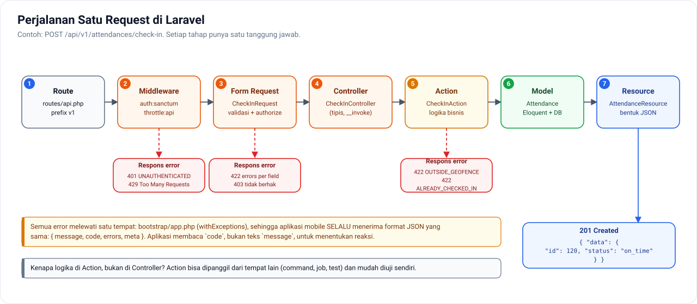

# 02 — Struktur Laravel API untuk Aplikasi Mobile

[← Kembali ke README](../README.md)

Blueprint untuk `absensi-api`. Mengasumsikan Laravel versi terbaru (11 ke atas, dengan struktur `bootstrap/app.php`).

---

## 1. Setup

```bash
laravel new absensi-api
```

```bash
cd absensi-api && php artisan install:api
```

```bash
composer require dedoc/scramble
```

```bash
composer require --dev pestphp/pest larastan/larastan
```

`install:api` memasang **Sanctum** dan membuat `routes/api.php`. Tambahkan trait `HasApiTokens` di model `User`.

---

## 2. Struktur Folder

```
app/
├── Actions/                         ← Satu class = satu use case bisnis
│   ├── Attendance/
│   │   ├── CheckInAction.php
│   │   └── CheckOutAction.php
│   └── Leave/
│       ├── SubmitLeaveRequestAction.php
│       └── ApproveLeaveRequestAction.php
├── Enums/
│   ├── AttendanceStatus.php
│   └── LeaveStatus.php
├── Events/
│   └── LeaveRequestStatusChanged.php       ← broadcast ke Reverb
├── Exceptions/
│   └── BusinessException.php               ← error bisnis dengan kode (OUTSIDE_GEOFENCE, dll)
├── Http/
│   ├── Controllers/Api/V1/
│   │   ├── Auth/
│   │   │   ├── LoginController.php
│   │   │   ├── LogoutController.php
│   │   │   └── MeController.php
│   │   ├── Attendance/
│   │   │   ├── TodayAttendanceController.php
│   │   │   ├── CheckInController.php
│   │   │   ├── CheckOutController.php
│   │   │   └── AttendanceHistoryController.php
│   │   ├── LeaveRequestController.php
│   │   ├── DeviceTokenController.php
│   │   └── AppConfigController.php
│   ├── Middleware/
│   │   └── EnsureIdempotency.php           ← Fase 4
│   ├── Requests/Api/V1/
│   │   ├── LoginRequest.php
│   │   ├── CheckInRequest.php
│   │   └── StoreLeaveRequestRequest.php
│   └── Resources/V1/
│       ├── UserResource.php
│       ├── AttendanceResource.php
│       └── LeaveRequestResource.php
├── Jobs/
│   ├── SendPushNotification.php
│   └── GenerateAttendanceThumbnail.php
├── Models/
├── Notifications/
├── Policies/
│   ├── AttendancePolicy.php
│   └── LeaveRequestPolicy.php
└── Services/
    ├── GeofenceService.php
    └── ExpoPushService.php
```

**Alur satu request:**


```
Route → Middleware (auth:sanctum, throttle) → FormRequest (validasi + authorize)
      → Controller (tipis) → Action (logika bisnis) → Model
      → Resource (bentuk JSON) → Response
```

---

## 3. Routing

### `routes/api.php`

```php
<?php

use App\Http\Controllers\Api\V1;
use Illuminate\Support\Facades\Route;

Route::prefix('v1')->name('v1.')->group(function () {

    // Publik
    Route::post('auth/login', V1\Auth\LoginController::class)
        ->middleware('throttle:login')->name('auth.login');
    Route::get('config', V1\AppConfigController::class)->name('config');

    // Perlu login
    Route::middleware(['auth:sanctum', 'throttle:api'])->group(function () {
        Route::post('auth/logout', V1\Auth\LogoutController::class)->name('auth.logout');
        Route::get('auth/me', V1\Auth\MeController::class)->name('auth.me');

        Route::prefix('attendances')->name('attendances.')->group(function () {
            Route::get('today', V1\Attendance\TodayAttendanceController::class)->name('today');
            Route::post('check-in', V1\Attendance\CheckInController::class)->name('check-in');
            Route::post('check-out', V1\Attendance\CheckOutController::class)->name('check-out');
            Route::get('/', V1\Attendance\AttendanceHistoryController::class)->name('index');
        });

        Route::apiResource('leave-requests', V1\LeaveRequestController::class)
            ->only(['index', 'store', 'show', 'destroy']);

        Route::post('devices', [V1\DeviceTokenController::class, 'store'])->name('devices.store');
        Route::delete('devices/{token}', [V1\DeviceTokenController::class, 'destroy'])->name('devices.destroy');
    });
});
```

### Rate limiter: `app/Providers/AppServiceProvider.php`

```php
use Illuminate\Cache\RateLimiting\Limit;
use Illuminate\Support\Facades\RateLimiter;

public function boot(): void
{
    RateLimiter::for('api', fn ($request) =>
        Limit::perMinute(60)->by($request->user()?->id ?: $request->ip())
    );

    RateLimiter::for('login', fn ($request) => [
        Limit::perMinute(5)->by($request->input('email').'|'.$request->ip()),
        Limit::perMinute(20)->by($request->ip()),
    ]);
}
```

---

## 4. Format Error yang Seragam

### `app/Exceptions/BusinessException.php`

```php
<?php

namespace App\Exceptions;

use Exception;

class BusinessException extends Exception
{
    public function __construct(
        string $message,
        public readonly string $errorCode,
        public readonly int $status = 422,
        public readonly array $meta = [],
    ) {
        parent::__construct($message);
    }
}
```

### `bootstrap/app.php`

```php
<?php

use App\Exceptions\BusinessException;
use Illuminate\Auth\AuthenticationException;
use Illuminate\Foundation\Application;
use Illuminate\Foundation\Configuration\Exceptions;
use Illuminate\Foundation\Configuration\Middleware;
use Illuminate\Http\Request;

return Application::configure(basePath: dirname(__DIR__))
    ->withRouting(
        web: __DIR__.'/../routes/web.php',
        api: __DIR__.'/../routes/api.php',
        channels: __DIR__.'/../routes/channels.php',
        commands: __DIR__.'/../routes/console.php',
        health: '/up',
    )
    ->withMiddleware(function (Middleware $middleware) {
        //
    })
    ->withExceptions(function (Exceptions $exceptions) {
        // Semua route api/* SELALU mengembalikan JSON
        $exceptions->shouldRenderJsonWhen(
            fn (Request $request) => $request->is('api/*') || $request->expectsJson()
        );

        $exceptions->render(function (BusinessException $e, Request $request) {
            return response()->json([
                'message' => $e->getMessage(),
                'code' => $e->errorCode,
                'meta' => (object) $e->meta,
            ], $e->status);
        });

        $exceptions->render(function (AuthenticationException $e, Request $request) {
            if ($request->is('api/*')) {
                return response()->json([
                    'message' => 'Sesi Anda telah berakhir. Silakan login kembali.',
                    'code' => 'UNAUTHENTICATED',
                ], 401);
            }
        });
    })->create();
```

---

## 5. Contoh Fitur Lengkap: Check-in

### `app/Http/Requests/Api/V1/CheckInRequest.php`

```php
<?php

namespace App\Http\Requests\Api\V1;

use Illuminate\Foundation\Http\FormRequest;

class CheckInRequest extends FormRequest
{
    public function authorize(): bool
    {
        return $this->user()->is_active;
    }

    public function rules(): array
    {
        return [
            'latitude' => ['required', 'numeric', 'between:-90,90'],
            'longitude' => ['required', 'numeric', 'between:-180,180'],
            'accuracy' => ['required', 'numeric', 'min:0'],
            'photo' => ['required', 'image', 'max:2048'],
            'client_recorded_at' => ['required', 'date'],
            'is_mock_location' => ['sometimes', 'boolean'],
        ];
    }

    public function messages(): array
    {
        return [
            'photo.required' => 'Foto selfie wajib diambil.',
            'photo.max' => 'Ukuran foto maksimal 2 MB.',
        ];
    }
}
```

### `app/Http/Controllers/Api/V1/Attendance/CheckInController.php`

```php
<?php

namespace App\Http\Controllers\Api\V1\Attendance;

use App\Actions\Attendance\CheckInAction;
use App\Http\Controllers\Controller;
use App\Http\Requests\Api\V1\CheckInRequest;
use App\Http\Resources\V1\AttendanceResource;

class CheckInController extends Controller
{
    public function __invoke(CheckInRequest $request, CheckInAction $checkIn): AttendanceResource
    {
        $attendance = $checkIn->execute($request->user(), $request->validated(), $request->file('photo'));

        return AttendanceResource::make($attendance);
    }
}
```

Controller hanya **menerima → mendelegasikan → mengembalikan**. Logika bisnisnya ada di Action.

### `app/Actions/Attendance/CheckInAction.php`

```php
<?php

namespace App\Actions\Attendance;

use App\Enums\AttendanceStatus;
use App\Exceptions\BusinessException;
use App\Jobs\GenerateAttendanceThumbnail;
use App\Models\Attendance;
use App\Models\User;
use App\Services\GeofenceService;
use Illuminate\Http\UploadedFile;
use Illuminate\Support\Carbon;
use Illuminate\Support\Facades\DB;

class CheckInAction
{
    public function __construct(private GeofenceService $geofence) {}

    public function execute(User $user, array $data, UploadedFile $photo): Attendance
    {
        $office = $user->office;
        $shift = $user->shift;
        $now = now($office->timezone);

        if ($user->attendances()->whereDate('date', $now->toDateString())->whereNotNull('check_in_at')->exists()) {
            throw new BusinessException('Anda sudah melakukan absen masuk hari ini.', 'ALREADY_CHECKED_IN');
        }

        $distance = $this->geofence->distanceMeters(
            $data['latitude'], $data['longitude'], $office->latitude, $office->longitude,
        );

        if ($distance > $office->radius_meters) {
            throw new BusinessException(
                'Anda berada di luar area kantor.',
                'OUTSIDE_GEOFENCE',
                meta: ['distance_meters' => round($distance), 'radius_meters' => $office->radius_meters],
            );
        }

        $shiftStart = Carbon::parse($now->toDateString().' '.$shift->start_time, $office->timezone);
        $status = $now->gt($shiftStart->copy()->addMinutes($shift->late_tolerance_minutes))
            ? AttendanceStatus::Late
            : AttendanceStatus::OnTime;

        return DB::transaction(function () use ($user, $data, $photo, $now, $distance, $status) {
            $path = $photo->store("attendances/{$user->id}/{$now->format('Y/m')}", 'public');

            $attendance = $user->attendances()->create([
                'office_id' => $user->office_id,
                'date' => $now->toDateString(),
                'check_in_at' => now(),                            // waktu SERVER
                'check_in_client_at' => $data['client_recorded_at'], // waktu HP (disimpan untuk audit)
                'check_in_latitude' => $data['latitude'],
                'check_in_longitude' => $data['longitude'],
                'check_in_accuracy' => $data['accuracy'],
                'check_in_distance' => round($distance),
                'check_in_photo_path' => $path,
                'is_mock_location' => $data['is_mock_location'] ?? false,
                'status' => $status,
            ]);

            GenerateAttendanceThumbnail::dispatch($attendance)->afterCommit();

            return $attendance;
        });
    }
}
```

### `app/Services/GeofenceService.php`

```php
<?php

namespace App\Services;

class GeofenceService
{
    private const EARTH_RADIUS_M = 6_371_000;

    public function distanceMeters(float $lat1, float $lng1, float $lat2, float $lng2): float
    {
        $dLat = deg2rad($lat2 - $lat1);
        $dLng = deg2rad($lng2 - $lng1);

        $a = sin($dLat / 2) ** 2
            + cos(deg2rad($lat1)) * cos(deg2rad($lat2)) * sin($dLng / 2) ** 2;

        return 2 * self::EARTH_RADIUS_M * asin(sqrt($a));
    }
}
```

### `app/Http/Resources/V1/AttendanceResource.php`

```php
<?php

namespace App\Http\Resources\V1;

use Illuminate\Http\Request;
use Illuminate\Http\Resources\Json\JsonResource;
use Illuminate\Support\Facades\Storage;

class AttendanceResource extends JsonResource
{
    public function toArray(Request $request): array
    {
        return [
            'id' => $this->id,
            'date' => $this->date->toDateString(),
            'check_in_at' => $this->check_in_at?->toIso8601String(),
            'check_out_at' => $this->check_out_at?->toIso8601String(),
            'status' => $this->status->value,
            'distance_meters' => $this->check_in_distance,
            'check_in_photo_url' => $this->check_in_photo_path
                ? Storage::disk('public')->url($this->check_in_photo_path)
                : null,
            'thumbnail_url' => $this->thumbnail_path
                ? Storage::disk('public')->url($this->thumbnail_path)
                : null,
            'work_duration_minutes' => $this->work_duration_minutes,
        ];
    }
}
```

> Untuk produksi, foto karyawan sebaiknya **tidak** disimpan di disk publik. Gunakan disk privat + `temporaryUrl()` (S3/R2) atau route yang dilindungi otorisasi.

### Test Pest: `tests/Feature/Api/V1/CheckInTest.php`

```php
<?php

use App\Models\Office;
use App\Models\User;
use Illuminate\Http\UploadedFile;
use Illuminate\Support\Facades\Storage;
use Laravel\Sanctum\Sanctum;

beforeEach(function () {
    Storage::fake('public');
    $this->office = Office::factory()->create([
        'latitude' => -6.175392, 'longitude' => 106.827153, 'radius_meters' => 100,
    ]);
    $this->user = User::factory()->for($this->office)->withShift()->create();
    Sanctum::actingAs($this->user);
});

function checkInPayload(array $override = []): array
{
    return array_merge([
        'latitude' => -6.175392,
        'longitude' => 106.827153,
        'accuracy' => 10,
        'client_recorded_at' => now()->toIso8601String(),
        'photo' => UploadedFile::fake()->image('selfie.jpg'),
    ], $override);
}

it('berhasil check-in di dalam radius kantor', function () {
    $this->postJson('/api/v1/attendances/check-in', checkInPayload())
        ->assertCreated()
        ->assertJsonStructure(['data' => ['id', 'date', 'check_in_at', 'status', 'check_in_photo_url']]);
});

it('menolak check-in di luar radius kantor', function () {
    $this->postJson('/api/v1/attendances/check-in', checkInPayload(['latitude' => -6.20]))
        ->assertUnprocessable()
        ->assertJsonPath('code', 'OUTSIDE_GEOFENCE');
});

it('menolak check-in dua kali dalam sehari', function () {
    $this->postJson('/api/v1/attendances/check-in', checkInPayload())->assertCreated();
    $this->postJson('/api/v1/attendances/check-in', checkInPayload())
        ->assertJsonPath('code', 'ALREADY_CHECKED_IN');
});

it('mewajibkan foto selfie', function () {
    $this->postJson('/api/v1/attendances/check-in', checkInPayload(['photo' => null]))
        ->assertUnprocessable()
        ->assertJsonValidationErrors('photo');
});
```

> `JsonResource::make()` yang dikembalikan dari request POST yang membuat model baru otomatis berstatus **201 Created** (karena `wasRecentlyCreated`).

---

## 6. Panel Admin

Untuk Fase 2 Sprint 4, gunakan **[Filament](https://filamentphp.com/)**: panel admin lengkap (CRUD karyawan, kantor, shift, persetujuan izin, laporan) dalam waktu singkat. Dengan begitu Anda bisa fokus ke aplikasi mobile.

---

[← Struktur RN](01-struktur-react-native.md) · [Lanjut → Konvensi API](03-konvensi-api.md)
