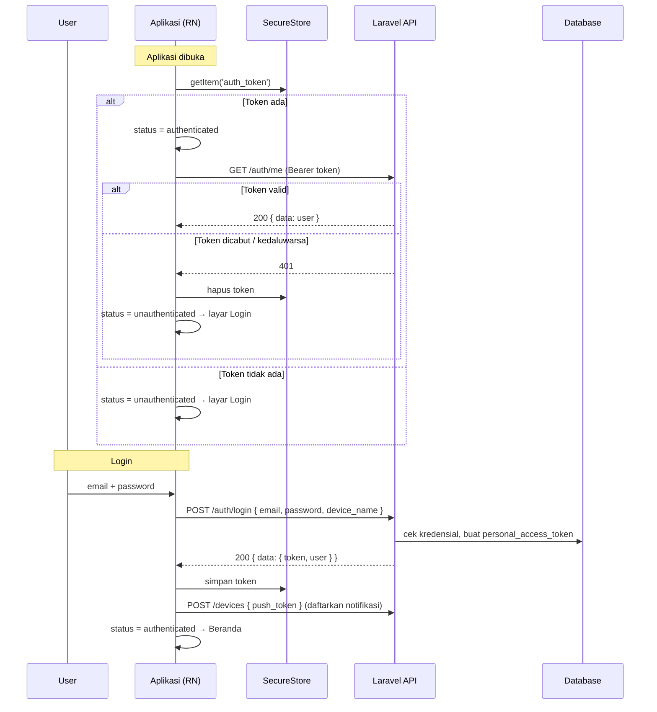

# 04 — Alur Autentikasi (Sanctum Token + Expo)

[← Kembali ke README](../README.md)

---

## 1. Gambaran Umum



---

## 2. Backend (Laravel)

### `LoginRequest.php`

```php
public function rules(): array
{
    return [
        'email' => ['required', 'email'],
        'password' => ['required', 'string'],
        'device_name' => ['required', 'string', 'max:100'], // contoh: "Samsung SM-A546E (Android 14)"
    ];
}
```

### `LoginController.php`

```php
<?php

namespace App\Http\Controllers\Api\V1\Auth;

use App\Exceptions\BusinessException;
use App\Http\Controllers\Controller;
use App\Http\Requests\Api\V1\LoginRequest;
use App\Http\Resources\V1\UserResource;
use App\Models\User;
use Illuminate\Support\Facades\Hash;

class LoginController extends Controller
{
    public function __invoke(LoginRequest $request)
    {
        $user = User::where('email', $request->email)->first();

        if (! $user || ! Hash::check($request->password, $user->password)) {
            throw new BusinessException('Email atau password salah.', 'INVALID_CREDENTIALS', 401);
        }

        if (! $user->is_active) {
            throw new BusinessException('Akun Anda dinonaktifkan. Hubungi admin.', 'ACCOUNT_INACTIVE', 403);
        }

        // Opsional: satu device = satu token. Hapus token lama dari device yang sama.
        $user->tokens()->where('name', $request->device_name)->delete();

        $token = $user->createToken(
            name: $request->device_name,
            abilities: ['*'],
            expiresAt: now()->addDays(30),
        )->plainTextToken;

        return response()->json([
            'data' => [
                'token' => $token,
                'user' => UserResource::make($user->load('office', 'shift')),
            ],
        ]);
    }
}
```

> **Catatan keamanan:** pesan untuk "email tidak terdaftar" dan "password salah" **harus sama**, supaya penyerang tidak bisa menebak email mana saja yang terdaftar.

> **Catatan status code:** login yang gagal mengembalikan `401`. Pastikan interceptor di aplikasi **tidak** memicu logout global untuk request ke `/auth/login` (lihat bagian 3).

### `LogoutController.php`

```php
public function __invoke(Request $request)
{
    // Hapus token yang sedang dipakai saja (device lain tetap login)
    $request->user()->currentAccessToken()->delete();

    // Hapus push token device ini, supaya notifikasi tidak terkirim ke HP yang sudah logout
    if ($pushToken = $request->input('push_token')) {
        $request->user()->deviceTokens()->where('token', $pushToken)->delete();
    }

    return response()->noContent();
}
```

### Masa Berlaku Token
- Di atas: `expiresAt: now()->addDays(30)` per token
- Atau secara global di `config/sanctum.php`: `'expiration' => 60 * 24 * 30` (dalam menit)
- Jadwalkan pembersihan token kedaluwarsa: `Schedule::command('sanctum:prune-expired --hours=24')->daily();`

### Fitur Admin: Cabut Akses
Admin menonaktifkan karyawan → `$user->tokens()->delete()` → request berikutnya dari HP karyawan mendapat 401 → aplikasi otomatis logout.

---

## 3. Mobile (React Native)

### Hook login: `src/features/auth/hooks.ts`

```ts
import { useMutation, useQuery } from '@tanstack/react-query';
import * as Device from 'expo-device';
import { queryKeys } from '@/lib/query-keys';
import { useAuthStore } from './store';
import * as authApi from './api';

export function useLogin() {
  const signIn = useAuthStore((s) => s.signIn);
  return useMutation({
    mutationFn: (input: { email: string; password: string }) =>
      authApi.login({
        ...input,
        device_name: `${Device.modelName ?? 'Unknown'} (${Device.osName} ${Device.osVersion})`,
      }),
    onSuccess: async ({ token }) => {
      await signIn(token);
      // Daftarkan push token di sini (lihat fitur notifications)
    },
  });
}

export function useMe() {
  const status = useAuthStore((s) => s.status);
  return useQuery({
    queryKey: queryKeys.me,
    queryFn: authApi.me,
    enabled: status === 'authenticated',
    staleTime: 5 * 60_000,
  });
}

export function useLogout() {
  const signOut = useAuthStore((s) => s.signOut);
  return useMutation({
    mutationFn: authApi.logout,
    // Tetap logout di HP walaupun request ke server gagal (misalnya offline)
    onSettled: () => signOut(),
  });
}
```

### Menampilkan error di form login

```tsx
const login = useLogin();

const onSubmit = handleSubmit((values) =>
  login.mutate(values, {
    onError: (error) => {
      if (error instanceof ApiError && error.isValidationError) {
        // Petakan error Laravel ke field react-hook-form
        Object.entries(error.fieldErrors).forEach(([field, messages]) =>
          setError(field as keyof LoginForm, { message: messages[0] }),
        );
      }
    },
  }),
);

// Pesan umum (kredensial salah, offline, dan sebagainya)
{login.error && !login.error.isValidationError && (
  <Text style={styles.error}>{login.error.message}</Text>
)}
```

### Pengecualian 401 untuk endpoint login

Di interceptor ([client.ts](01-struktur-react-native.md#srclibapiclientts-axios-instance)), jangan logout global untuk 401 dari `/auth/login`:

```ts
api.interceptors.response.use(
  (response) => response,
  (error) => {
    const apiError = toApiError(error);
    const isLoginRequest = error.config?.url?.includes('/auth/login');
    if (apiError.status === 401 && !isLoginRequest) unauthorizedHandler?.();
    return Promise.reject(apiError);
  },
);
```

---

## 4. Skenario yang Wajib Diuji

| # | Skenario | Hasil yang diharapkan |
|---|---|---|
| 1 | Login dengan benar | Masuk ke Beranda, token tersimpan |
| 2 | Password salah | Pesan "Email atau password salah", tetap di layar login |
| 3 | Field kosong | Error validasi per field (dari Zod di klien) |
| 4 | Login saat offline | Pesan "Tidak ada koneksi internet" |
| 5 | Tutup aplikasi lalu buka lagi | Langsung masuk Beranda tanpa login |
| 6 | Token dihapus dari database | Request berikutnya 401 → otomatis ke layar login |
| 7 | 3 request paralel mendapat 401 | Logout hanya terjadi **sekali** |
| 8 | Logout saat offline | Tetap logout di HP |
| 9 | Logout lalu login sebagai user lain | **Tidak ada** data user sebelumnya yang terlihat (`queryClient.clear()`) |
| 10 | Akun dinonaktifkan admin | Logout otomatis + pesan "Akun dinonaktifkan" |
| 11 | Login 6x salah dalam 1 menit | 429 + pesan "Coba lagi dalam X detik" |

---

[← Konvensi API](03-konvensi-api.md) · [Lanjut → Proyek Absensi](../proyek-absensi/01-prd.md)
