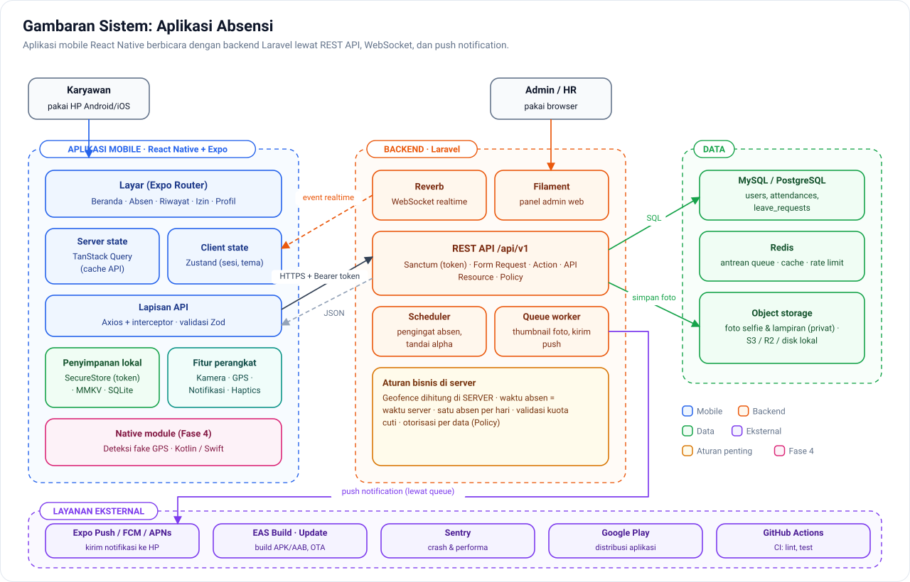
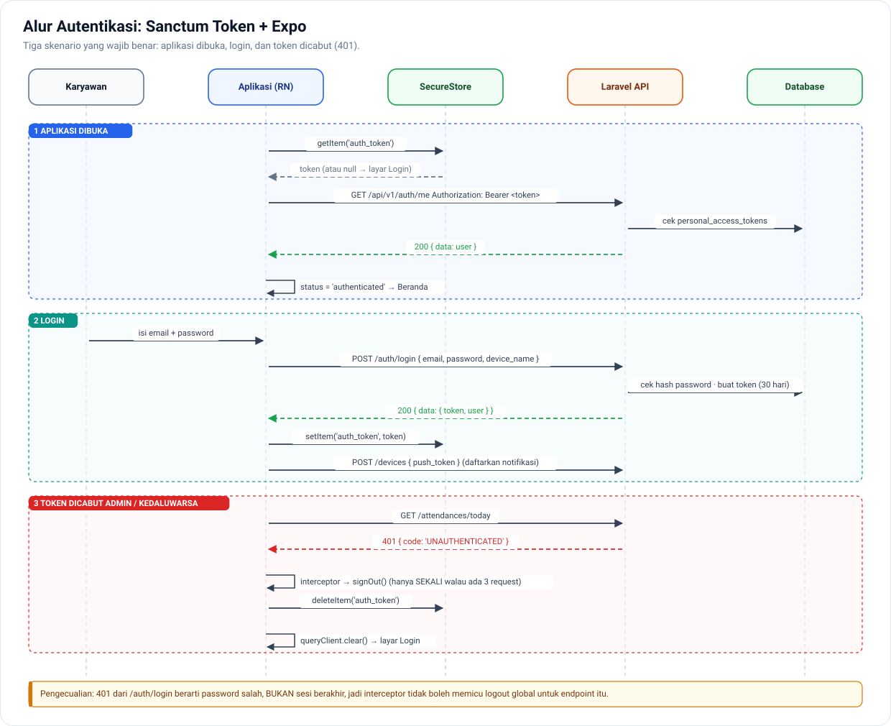
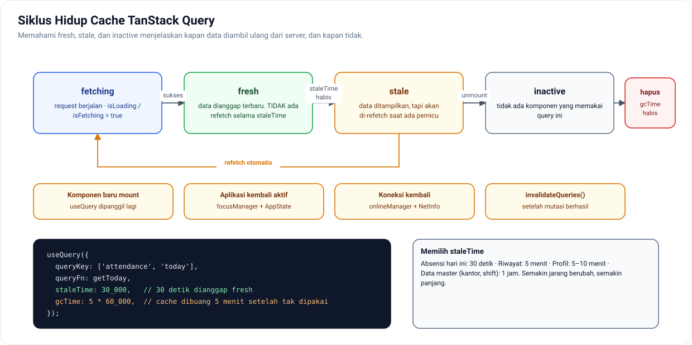
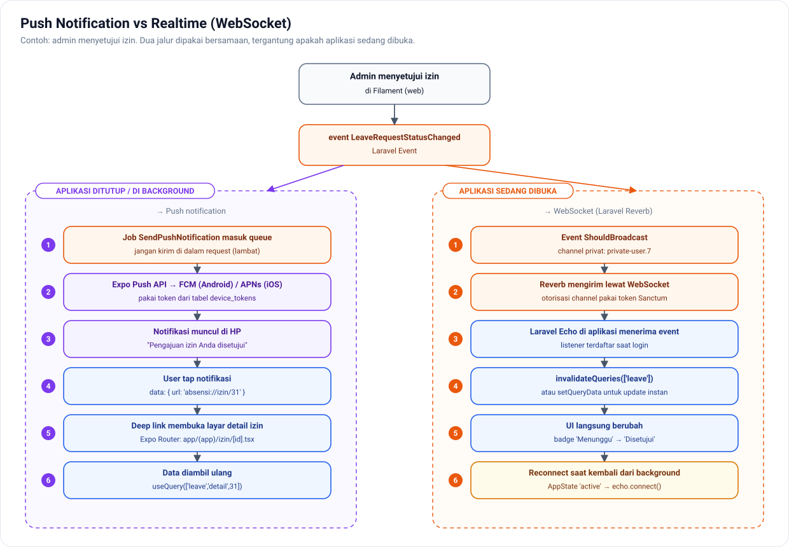
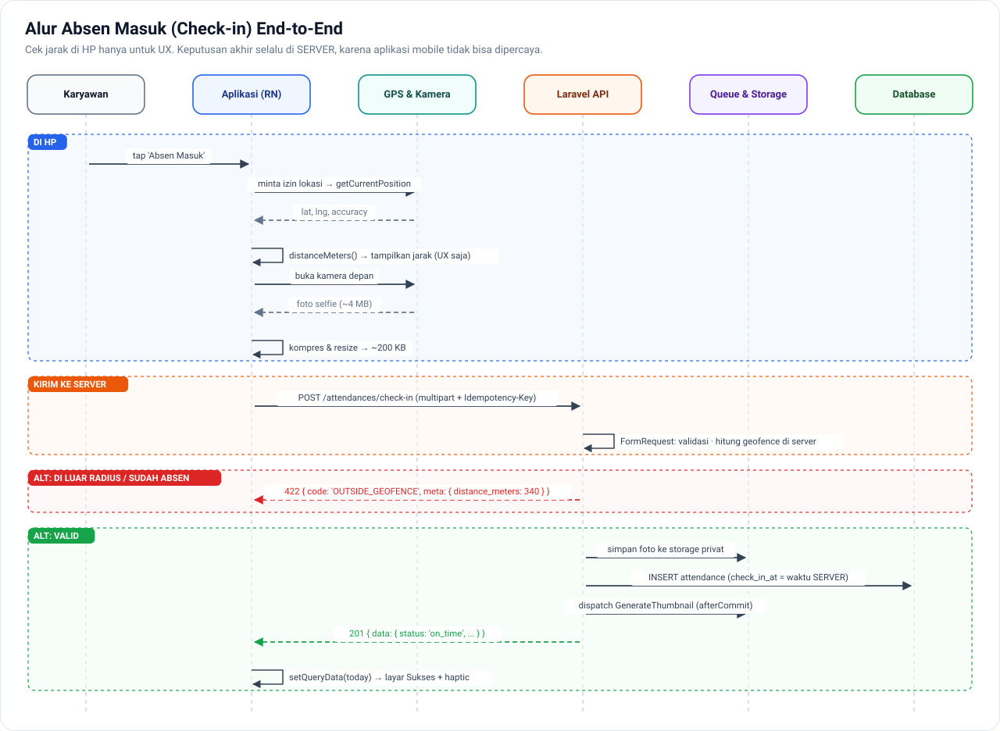

# Fase 2 — Aplikasi Nyata dengan API Laravel

[← Kembali ke README](../README.md) · **Durasi: 12 minggu** · Repo: `absensi-api`, `absensi-mobile`

## Tujuan Fase

Menghubungkan aplikasi mobile ke backend Laravel **dengan cara profesional**: autentikasi yang aman, cache data yang pintar, upload file, push notification, dan realtime. Di fase ini keunggulan Anda sebagai developer Laravel mulai terasa.

**Hasil akhir fase:** **Aplikasi Absensi Karyawan v1**. Desain lengkapnya ada di folder [`proyek-absensi/`](../proyek-absensi/01-prd.md).

> 📌 Sebelum mulai, baca blueprint arsitektur:
> [Struktur RN](../arsitektur/01-struktur-react-native.md) · [Struktur Laravel](../arsitektur/02-struktur-laravel-api.md) · [Konvensi API](../arsitektur/03-konvensi-api.md) · [Alur Auth](../arsitektur/04-alur-autentikasi.md)

*Gambaran sistem yang akan Anda bangun di fase ini. Penjelasan lengkap: arsitektur/00-dokumen-arsitektur.md*

---

## Minggu 1 — Fondasi API Laravel untuk Mobile

🎯 **Tujuan:** API yang konsisten dan nyaman dikonsumsi aplikasi mobile.

📚 **Materi**
- `php artisan install:api` untuk menyiapkan Sanctum dan `routes/api.php`
- **Versioning**: prefix `/api/v1`. Aplikasi mobile versi lama tetap berjalan bertahun-tahun, jadi API tidak boleh berubah sembarangan.
- **API Resource** (`JsonResource`) untuk mengontrol bentuk response; jangan pernah me-return model mentah
- **Form Request** untuk validasi
- **Format response dan error yang seragam** (lihat [konvensi API](../arsitektur/03-konvensi-api.md))
- Exception handling terpusat di `bootstrap/app.php` (`withExceptions`)
- Rate limiting (`RateLimiter::for`)
- Dokumentasi API otomatis: [Scramble](https://scramble.dedoc.co/) (OpenAPI)

🛠 **Latihan**
1. Siapkan repo `absensi-api` mengikuti [struktur Laravel](../arsitektur/02-struktur-laravel-api.md).
2. Buat migrasi dan model sesuai [desain database](../proyek-absensi/02-database.md).
3. Buat endpoint `GET /api/v1/offices` dengan Resource dan pagination.
4. Pastikan error 401, 403, 404, 422, 429, dan 500 semuanya mengikuti format JSON yang sama.
5. Pasang Scramble dan buka dokumentasinya di `/docs/api`.

✅ **Checkpoint**
- Kenapa aplikasi mobile butuh versioning API, sedangkan aplikasi web biasanya tidak?

---

## Minggu 2 — Autentikasi End-to-End

🎯 **Tujuan:** login yang aman dan tahan banting di sisi mobile.

📚 **Materi**
- **Sanctum token** (bukan cookie/session, karena ini aplikasi mobile)
- Endpoint: `POST /auth/login` (dengan `device_name`), `POST /auth/logout`, `GET /auth/me`
- Di mobile:
  - Token disimpan di **`expo-secure-store`**
  - **Axios instance** + interceptor: tambahkan header `Authorization`, dan tangani **401 secara global** (logout otomatis)
  - Store auth dengan **Zustand**: status `checking | authenticated | unauthenticated`
  - **Protected route** dengan Expo Router (redirect di `_layout.tsx`)
  - Splash screen ditahan sampai status auth diketahui (`expo-splash-screen`)
- Detail lengkap: [Alur Autentikasi](../arsitektur/04-alur-autentikasi.md)

🛠 **Latihan**
1. Implementasikan login, logout, dan auto-login saat aplikasi dibuka ulang.
2. Hapus token di database (simulasi token dicabut admin), lalu pastikan aplikasi otomatis keluar ke layar login.
3. Tampilkan pesan error validasi dari Laravel (422) di bawah field yang sesuai.

✅ **Checkpoint**
- Apa yang terjadi kalau 3 request berjalan bersamaan dan semuanya mendapat 401? (Pastikan logout hanya terjadi sekali.)

---

## Minggu 3 — TanStack Query: Dasar

🎯 **Tujuan:** berhenti menulis `useEffect` + `useState` untuk fetch data.

📚 **Materi**
- Konsep **server state** vs **client state**
- `QueryClientProvider`, `useQuery`, `useMutation`
- **Query key** dan *query key factory* (lihat [struktur RN](../arsitektur/01-struktur-react-native.md))
- `staleTime` vs `gcTime`, refetch otomatis, `enabled`
- Invalidasi cache setelah mutasi: `queryClient.invalidateQueries`
- Integrasi ke React Native: `focusManager` + `AppState`, dan `onlineManager` + `@react-native-community/netinfo`
- Sumber: [TanStack Query docs](https://tanstack.com/query/latest/docs/framework/react/overview) · [React Native guide](https://tanstack.com/query/latest/docs/framework/react/react-native)

🛠 **Latihan**
1. Buat hooks `useMe()`, `useTodayAttendance()`, `useAttendanceHistory()`.
2. Pasang Devtools atau logger, lalu amati kapan data diambil ulang.
3. Atur `staleTime` yang masuk akal per jenis data, dan tulis alasannya di `CATATAN.md`.

✅ **Checkpoint**
- Kenapa data dari server sebaiknya **tidak** disalin ke Zustand atau Redux?

---

## Minggu 4 — TanStack Query: Lanjutan

🎯 **Tujuan:** pola data tingkat produksi.

📚 **Materi**
- `useInfiniteQuery` + **cursor pagination** Laravel (`cursorPaginate`)
- **Optimistic update**: `onMutate` → rollback di `onError` → `onSettled` invalidate
- Retry yang pintar (jangan retry error 4xx)
- Prefetch data sebelum user membuka layar
- Persist cache ke penyimpanan (`@tanstack/query-async-storage-persister`) supaya data muncul instan saat aplikasi dibuka

🛠 **Latihan**
1. Riwayat absensi dengan infinite scroll memakai cursor pagination.
2. Pengajuan izin dengan optimistic update: item langsung muncul di list, dan dibatalkan kalau server menolak.
3. Matikan internet: aplikasi tetap menampilkan data cache dan banner "Offline".

✅ **Checkpoint**
- Kenapa cursor pagination lebih cocok untuk infinite scroll dibanding offset pagination?

---

## Minggu 5 — State Management Client dengan Zustand

🎯 **Tujuan:** mengelola state yang memang milik client.

📚 **Materi**
- [Zustand](https://zustand.docs.pmnd.rs/): `create`, selector, `persist` middleware (dengan MMKV)
- Selector untuk mencegah re-render berlebih: `useStore(s => s.x)`, `useShallow`
- **Contoh state client:** status auth, preferensi tema, draft form, onboarding sudah dilihat atau belum
- **Bukan state client:** daftar absensi, profil user. Itu server state dan tempatnya di TanStack Query.

🛠 **Latihan**
1. Refactor store auth agar memakai selector.
2. Store `settings` (tema, bahasa) yang persist ke MMKV.
3. Ukur re-render sebelum dan sesudah memakai selector.

✅ **Checkpoint**
- Buat tabel: untuk setiap data di aplikasi absensi, di mana ia disimpan (Query, Zustand, SecureStore, atau SQLite) dan kenapa.

---

## Minggu 6 — Upload File & Foto

🎯 **Tujuan:** upload foto selfie absensi yang andal di jaringan lambat.

📚 **Materi**
- Ambil foto dengan `expo-camera` (kamera depan)
- **Kompresi dan resize** sebelum upload (`expo-image-manipulator`), dari sekitar 4 MB menjadi sekitar 200 KB
- Upload `multipart/form-data` dengan Axios, plus progress (`onUploadProgress`)
- Laravel: validasi `image|max:2048`, simpan ke `storage` (`Storage::disk(...)`), lalu buat URL
- Opsional: upload langsung ke S3/R2 dengan *presigned URL* (server tidak menanggung beban file)

🛠 **Latihan**
1. Endpoint `POST /api/v1/attendances/check-in` menerima foto, latitude, dan longitude.
2. Tampilkan progress upload dan tombol "Coba lagi" saat gagal.
3. Uji di jaringan lambat (atur throttling di emulator Android).

✅ **Checkpoint**
- Kenapa kompresi di sisi HP penting untuk pengguna di Indonesia (kuota, sinyal)?

---

## Minggu 7 — Push Notification

🎯 **Tujuan:** Laravel bisa mengirim notifikasi ke HP user.

*Minggu 7 (push) dan Minggu 8 (realtime) bekerja berdampingan.*

📚 **Materi**
- `expo-notifications`: minta izin, ambil **Expo Push Token** (atau token FCM/APNs langsung)
- Simpan token ke Laravel: `POST /api/v1/devices` (tabel `device_tokens`, satu user bisa punya banyak device)
- Mengirim dari Laravel:
  - **Expo Push API** (paling mudah), atau
  - FCM langsung (misalnya dengan package `laravel-notification-channels/fcm`)
- Kirim lewat **Laravel Queue** (job), jangan di dalam request
- Menangani notifikasi:
  - Saat aplikasi terbuka (foreground handler)
  - Saat ditekan: buka layar terkait (deep link ke `/izin/12`)
- Hapus token yang sudah tidak valid
- Sumber: [Expo push notifications](https://docs.expo.dev/push-notifications/overview/)

🛠 **Latihan**
1. Notifikasi "Pengajuan izin Anda disetujui" saat admin menyetujui, lalu ditekan membuka detail izin.
2. Scheduled command Laravel: pengingat "Jangan lupa absen masuk" pukul 07.45 untuk yang belum absen.
3. Notifikasi lokal: pengingat absen pulang.

✅ **Checkpoint**
- Kenapa pengiriman notifikasi harus lewat queue?

---

## Minggu 8 — Realtime dengan Laravel Reverb

🎯 **Tujuan:** data yang berubah langsung muncul tanpa refresh.

📚 **Materi**
- [Laravel Reverb](https://laravel.com/docs/reverb): server WebSocket resmi Laravel
- Broadcasting event: `ShouldBroadcast`, public channel vs **private channel**
- Otorisasi channel privat dengan token Sanctum (`Broadcast::routes(['middleware' => ['auth:sanctum']])`)
- Di RN: `laravel-echo` + `pusher-js` (protokol Reverb kompatibel dengan Pusher)
- Saat event diterima, panggil `queryClient.invalidateQueries` atau `setQueryData`
- Reconnect saat aplikasi kembali dari background

🛠 **Latihan**
1. Admin menyetujui izin → status di aplikasi karyawan langsung berubah (private channel `user.{id}`).
2. Dashboard admin (web) memperlihatkan karyawan yang baru absen secara live.

✅ **Checkpoint**
- Kapan memakai push notification, dan kapan WebSocket? (Petunjuk: aplikasi sedang dibuka atau tidak.)

---

## Minggu 9–12 — 🏁 Proyek Utama: Aplikasi Absensi v1

Ikuti rencana sprint di [`proyek-absensi/05-milestone.md`](../proyek-absensi/05-milestone.md):

*Alur inti yang dibangun di Sprint 2.*

| Minggu | Sprint | Fokus |
|---|---|---|
| 9 | Sprint 1 | Auth, profil, data kantor & shift, layar beranda |
| 10 | Sprint 2 | Check-in/out: GPS + validasi geofence + selfie |
| 11 | Sprint 3 | Riwayat, pengajuan izin/cuti, notifikasi |
| 12 | Sprint 4 | Panel admin (Filament), realtime, polishing, demo |

Dokumen pendukung:
- [PRD: kebutuhan produk](../proyek-absensi/01-prd.md)
- [Desain database](../proyek-absensi/02-database.md)
- [Spesifikasi API](../proyek-absensi/03-api-spec.md)
- [Layar & alur](../proyek-absensi/04-layar-dan-alur.md)

✅ **Checkpoint Fase 2**
- [ ] Login, logout, auto-login, dan penanganan token kedaluwarsa berjalan benar
- [ ] Tidak ada `useEffect` untuk fetch data; semuanya lewat TanStack Query
- [ ] Check-in ditolak server kalau user berada di luar radius kantor (validasi di **server**, bukan hanya di HP)
- [ ] Upload foto tetap aman di jaringan lambat
- [ ] Push notification dan realtime berjalan
- [ ] Dokumentasi API (Scramble) tersedia
- [ ] Kedua repo punya README, screenshot, dan diagram arsitektur

---

← [Fase 1](fase-1-react-native-dasar.md) · Lanjut ke → [Fase 3: Kualitas & Arsitektur](fase-3-kualitas-arsitektur.md)
