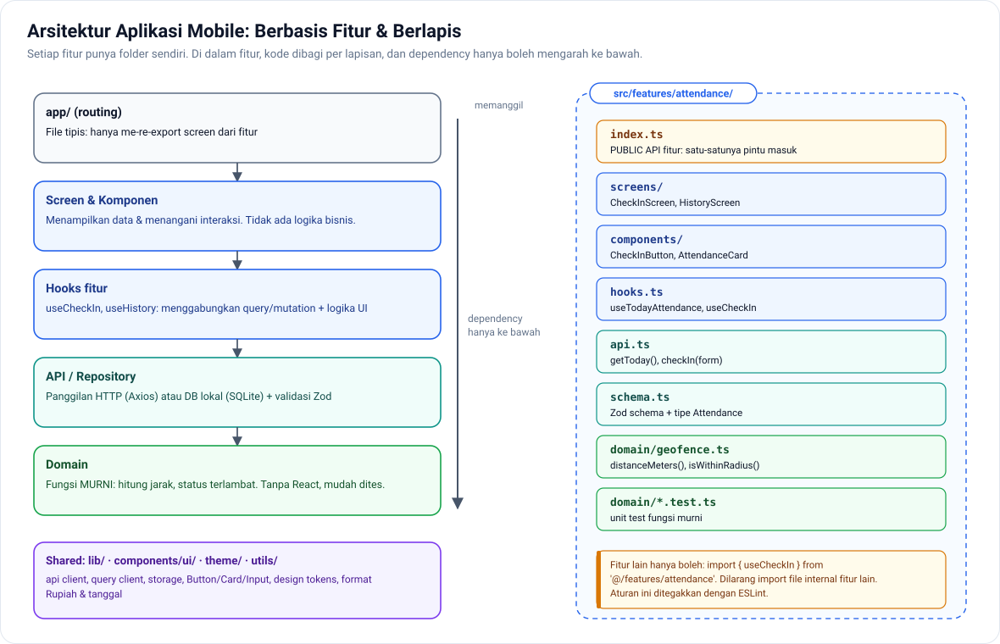
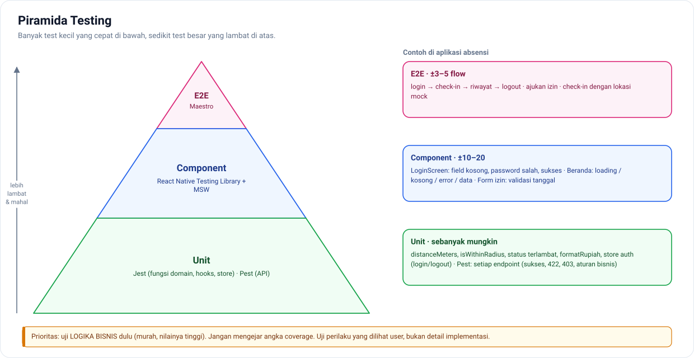
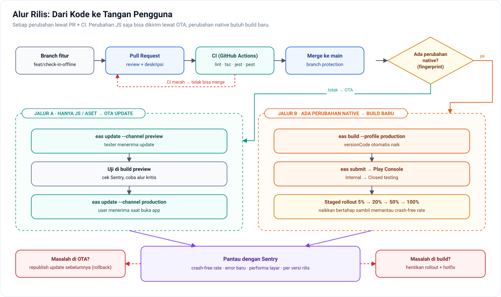

# Fase 3 — Kualitas, Arsitektur, CI/CD & Rilis

[← Kembali ke README](../README.md) · **Durasi: 12 minggu** · Repo: `absensi-mobile`, `absensi-api`

## Tujuan Fase

Mengubah aplikasi yang "jalan" menjadi aplikasi yang **bisa dirawat tim, diuji otomatis, dan dirilis dengan aman**. Di fase inilah biasanya beda junior dan mid-level paling terlihat.

**Hasil akhir fase:** aplikasi absensi **rilis di Google Play** (minimal di track testing), dengan pipeline CI/CD, test otomatis, dan monitoring crash.

---

## Minggu 1–2 — Refactor ke Arsitektur Berbasis Fitur

🎯 **Tujuan:** kode yang mudah dicari, diubah, dan diuji.



📚 **Materi**
- **Feature-based structure**: kode dikelompokkan per fitur (`features/attendance`, `features/leave`), bukan per jenis file (`components/`, `hooks/`)
- Pemisahan layer:
  ```
  UI (screens, components)     → hanya menampilkan dan memanggil hooks
  Hooks (useCheckIn, ...)      → menggabungkan query/mutation + logika UI
  API / Repository             → komunikasi HTTP atau DB lokal
  Domain (types, schema, util) → logika murni, tanpa React, mudah dites
  ```
- **Aturan dependency**: fitur tidak boleh meng-import isi internal fitur lain; hanya lewat `index.ts` (public API)
- Batas import ditegakkan dengan ESLint (`import/no-restricted-paths` atau `eslint-plugin-boundaries`)
- Path alias `@/` di `tsconfig.json`
- Menulis **ADR** (*Architecture Decision Record*): satu file per keputusan penting
- Blueprint lengkap: [arsitektur/01-struktur-react-native.md](../arsitektur/01-struktur-react-native.md)

🛠 **Latihan**
1. Refactor `absensi-mobile` ke struktur berbasis fitur.
2. Pindahkan logika murni (hitung jarak geofence, format durasi kerja, status terlambat) ke `domain/`.
3. Tulis 3 ADR di folder `docs/adr/`, misalnya: *0001-pakai-tanstack-query*, *0002-struktur-berbasis-fitur*, *0003-token-di-securestore*.

✅ **Checkpoint**
- Kalau fitur "Lembur" ditambahkan besok, file mana saja yang Anda buat atau ubah? (Idealnya hampir semuanya di satu folder.)

---

## Minggu 3 — Unit Test dengan Jest

🎯 **Tujuan:** logika penting terlindungi oleh test.



*Peta testing untuk Minggu 3–6.*

📚 **Materi**
- Setup `jest-expo` (preset Jest untuk Expo)
- Struktur test: `describe`, `it`, `expect`, *Arrange–Act–Assert*
- Menguji **fungsi domain** (prioritas utama: murah dan bernilai tinggi)
- Mock: `jest.fn()`, `jest.mock()`, *fake timers*
- Menguji custom hooks: `renderHook`
- Sumber: [Expo: Unit testing](https://docs.expo.dev/develop/unit-testing/) · [Jest docs](https://jestjs.io/docs/getting-started)

🛠 **Latihan**
Tulis test untuk:
1. `hitungJarak(lat1, lng1, lat2, lng2)` (rumus haversine) dan `isDalamRadius()`
2. `statusKehadiran(jamMasuk, shift)` → `tepat_waktu | terlambat`, termasuk kasus batas (tepat di menit toleransi)
3. Fungsi format: durasi kerja, Rupiah, tanggal Indonesia
4. Store Zustand auth: login, lalu logout, lalu state ter-reset

✅ **Checkpoint**
- Kenapa menguji fungsi domain lebih bernilai daripada mengejar persentase coverage?

---

## Minggu 4 — Component Test dengan React Native Testing Library

🎯 **Tujuan:** menguji layar seperti cara user memakainya.

📚 **Materi**
- [React Native Testing Library](https://callstack.github.io/react-native-testing-library/): `render`, `screen`, `fireEvent`/`userEvent`, `waitFor`
- Query berdasarkan **apa yang dilihat user**: `getByRole`, `getByText`, `getByLabelText` (sekaligus melatih aksesibilitas)
- **MSW (Mock Service Worker)** untuk me-mock API di level jaringan
- Wrapper test: `QueryClientProvider` khusus test (dengan `retry: false`)

🛠 **Latihan**
1. Test layar login: validasi kosong, kredensial salah (pesan error muncul), sukses (navigasi terpanggil).
2. Test layar riwayat: state loading, kosong, error, dan data tampil.
3. Test form pengajuan izin: validasi tanggal.

✅ **Checkpoint**
- Kenapa sebaiknya tidak menguji *implementation detail* seperti nilai state internal?

---

## Minggu 5 — End-to-End Test dengan Maestro

🎯 **Tujuan:** alur kritis teruji otomatis di aplikasi sungguhan.

📚 **Materi**
- [Maestro](https://maestro.mobile.dev/): flow dalam YAML, berjalan di emulator
- `testID` di komponen untuk selector yang stabil
- Flow kritis yang wajib punya E2E: login → check-in → lihat riwayat → logout
- Menyiapkan data test di backend (seeder khusus E2E)

🛠 **Latihan**
```yaml
# .maestro/login-checkin.yaml
appId: com.caesarovera.absensi
---
- launchApp:
    clearState: true
- tapOn:
    id: "input-email"
- inputText: "karyawan@demo.test"
- tapOn:
    id: "input-password"
- inputText: "password"
- tapOn: "Masuk"
- assertVisible: "Selamat pagi"
```
Buat minimal 3 flow: login, check-in (dengan lokasi mock), dan pengajuan izin.

✅ **Checkpoint**
- Bagaimana *testing pyramid* diterapkan di proyek ini: berapa banyak unit, component, dan E2E test?

---

## Minggu 6 — Testing Backend Laravel dengan Pest

🎯 **Tujuan:** API terjamin. Kalau API berubah tanpa sengaja, aplikasi mobile ikut rusak.

📚 **Materi**
- [Pest](https://pestphp.com/): feature test untuk endpoint API
- `actingAs` dengan Sanctum (`Sanctum::actingAs($user)`)
- Assert struktur JSON (`assertJsonStructure`), sehingga perubahan "kontrak" API terdeteksi
- Factory dan database refresh
- `Queue::fake()`, `Notification::fake()`, `Storage::fake()`, `Event::fake()`

🛠 **Latihan**
1. Test check-in: sukses di dalam radius, ditolak di luar radius, ditolak kalau sudah check-in, foto wajib ada.
2. Test otorisasi: karyawan tidak bisa melihat absensi karyawan lain.
3. Test bahwa notifikasi masuk antrean saat izin disetujui.

✅ **Checkpoint**
- Apa itu *API contract*, dan kenapa ia harus dites ketika kliennya aplikasi mobile?

---

## Minggu 7 — Environment & Konfigurasi

🎯 **Tujuan:** memisahkan dev, staging, dan production dengan rapi.

📚 **Materi**
- `app.config.ts` (konfigurasi dinamis) menggantikan `app.json`
- Variabel `EXPO_PUBLIC_*` untuk nilai publik seperti URL API. **Rahasia tidak boleh masuk bundle aplikasi.**
- **App variants**: package/bundle ID berbeda per environment, sehingga dev dan prod bisa terpasang bersamaan
- Nama dan ikon berbeda per varian (misalnya "Absensi (Dev)")
- Sumber: [Expo: Environment variables](https://docs.expo.dev/guides/environment-variables/) · [App variants](https://docs.expo.dev/tutorial/eas/multiple-app-variants/)

🛠 **Latihan**
```ts
// app.config.ts (contoh)
const VARIANT = process.env.APP_VARIANT ?? 'development';
const suffix = { development: '.dev', preview: '.preview', production: '' }[VARIANT];

export default {
  name: VARIANT === 'production' ? 'Absensi' : `Absensi (${VARIANT})`,
  slug: 'absensi',
  android: { package: `com.caesarovera.absensi${suffix}` },
  ios: { bundleIdentifier: `com.caesarovera.absensi${suffix}` },
};
```
Siapkan juga 3 environment di backend: lokal, staging (VPS murah atau layanan PaaS), dan production.

---

## Minggu 8 — EAS Build & Credentials

🎯 **Tujuan:** build APK/AAB di cloud, tanpa ribet konfigurasi lokal.

📚 **Materi**
- `eas.json`: profile `development`, `preview`, `production`
- **Development build** (`developmentClient: true`) untuk dipakai sehari-hari
- Signing Android: keystore dikelola EAS (**backup keystore**, karena kalau hilang Anda tidak bisa update aplikasi)
- APK (untuk dibagikan langsung) vs AAB (untuk Play Store)
- Build iOS di cloud tanpa Mac (butuh akun Apple Developer berbayar)
- Sumber: [EAS Build](https://docs.expo.dev/build/introduction/)

🛠 **Latihan**
1. `eas build --profile preview --platform android` lalu install APK-nya di HP.
2. Bagikan APK ke 2–3 teman untuk dicoba dan kumpulkan feedback.

---

## Minggu 9 — CI dengan GitHub Actions

🎯 **Tujuan:** setiap Pull Request otomatis dicek.



*Gambaran Minggu 8–12: dari PR sampai ke tangan pengguna.*

📚 **Materi**
- Workflow di `.github/workflows/`
- Pipeline PR mobile: install → **lint** → **typecheck** (`tsc --noEmit`) → **test**
- Pipeline PR backend: `composer install` → Pint → PHPStan/Larastan → Pest
- Build otomatis saat push tag `v*`, memakai `expo/expo-github-action` + `EXPO_TOKEN` di secrets
- Branch protection: PR tidak bisa di-merge kalau CI merah

🛠 **Latihan**
```yaml
# .github/workflows/ci.yml (mobile)
name: CI
on: [pull_request]
jobs:
  check:
    runs-on: ubuntu-latest
    steps:
      - uses: actions/checkout@v4
      - uses: actions/setup-node@v4
        with: { node-version: 'lts/*', cache: 'npm' }
      - run: npm ci
      - run: npm run lint
      - run: npx tsc --noEmit
      - run: npm test -- --ci
```
Mulai sekarang biasakan **alur kerja dengan PR**, meskipun Anda bekerja sendiri: branch fitur → PR → CI hijau → merge.

---

## Minggu 10 — OTA Update dengan EAS Update

🎯 **Tujuan:** memperbaiki bug JS tanpa menunggu review Play Store.

📚 **Materi**
- Cara kerja OTA: hanya bundle **JS dan aset** yang diperbarui; perubahan native tetap butuh build baru
- **Channel** dan **branch** (`production`, `preview`)
- **`runtimeVersion`**: mencegah bundle JS dikirim ke aplikasi dengan kode native yang tidak cocok (pakai policy `fingerprint`)
- **Rollback** saat update bermasalah
- Batasan kebijakan store: OTA untuk perbaikan dan perubahan kecil, bukan untuk mengubah fungsi utama aplikasi
- Sumber: [EAS Update](https://docs.expo.dev/eas-update/introduction/)

🛠 **Latihan**
1. Rilis build preview, lalu kirim update OTA yang mengubah teks. Pastikan HP menerimanya.
2. Lakukan simulasi rollback.
3. Tulis **SOP rilis** di `docs/RELEASE.md`: kapan cukup OTA, kapan perlu build baru, dan checklist sebelum rilis.

✅ **Checkpoint**
- Kalau Anda menambah library dengan kode native, lalu mengirimnya lewat OTA, apa yang terjadi? Bagaimana `runtimeVersion` mencegahnya?

---

## Minggu 11 — Monitoring dengan Sentry

🎯 **Tujuan:** tahu ada crash **sebelum** user komplain.

📚 **Materi**
- `@sentry/react-native` + plugin Expo
- **Source map** supaya stack trace terbaca (upload otomatis saat build/update)
- `release` dan `dist`, untuk tahu crash berasal dari versi mana
- Breadcrumbs, user context (ID saja, **jangan kirim data pribadi**), tags
- Performance monitoring: navigasi lambat, request lambat
- Pasang Sentry juga di Laravel, supaya error bisa ditelusuri dari mobile sampai backend
- Sumber: [Sentry for React Native](https://docs.sentry.io/platforms/react-native/)

🛠 **Latihan**
1. Buat tombol tersembunyi "Test Crash" di build dev, lalu pastikan error muncul di Sentry dengan stack trace yang terbaca.
2. Pasang Error Boundary dengan layar "Terjadi kesalahan" + tombol muat ulang.
3. Buat alert ke email saat ada error baru di production.

---

## Minggu 12 — 🏁 Rilis ke Google Play

🎯 **Tujuan:** aplikasi Anda ada di Play Store.

📚 **Materi & Checklist**
- [ ] Akun Google Play Console (biaya pendaftaran sekali bayar)
- [ ] **Catatan kebijakan:** akun pribadi baru wajib menjalankan **closed testing** dengan sejumlah tester selama periode tertentu sebelum boleh rilis production. Cek syarat terbarunya di Play Console, dan siapkan tester dari teman atau komunitas.
- [ ] Ikon, *feature graphic*, minimal 4 screenshot
- [ ] Deskripsi aplikasi (singkat dan lengkap)
- [ ] **Kebijakan privasi** (URL publik; bisa di-host di Laravel Anda)
- [ ] Formulir **Data Safety**: lokasi, foto, data pribadi apa saja yang dikumpulkan dan untuk apa
- [ ] Deklarasi izin lokasi; kalau memakai lokasi di background, butuh justifikasi khusus (sebaiknya **hindari**)
- [ ] Akun demo untuk reviewer Google
- [ ] Target API level sesuai syarat terbaru Google Play
- [ ] `eas submit --platform android`
- [ ] Rilis ke track **Internal → Closed → Production**

✅ **Checkpoint Fase 3**
- [ ] Struktur berbasis fitur + aturan import ditegakkan ESLint
- [ ] Unit, component, dan E2E test berjalan (backend juga punya test)
- [ ] CI hijau di setiap PR, untuk mobile maupun backend
- [ ] 3 environment terpisah
- [ ] OTA update + SOP rilis tertulis
- [ ] Sentry aktif dengan source map
- [ ] **Aplikasi tersedia di Google Play** (minimal track testing)
- [ ] Minimal 5 ADR tertulis

---

← [Fase 2](fase-2-aplikasi-nyata-laravel.md) · Lanjut ke → [Fase 4: Topik Senior](fase-4-topik-senior.md)
