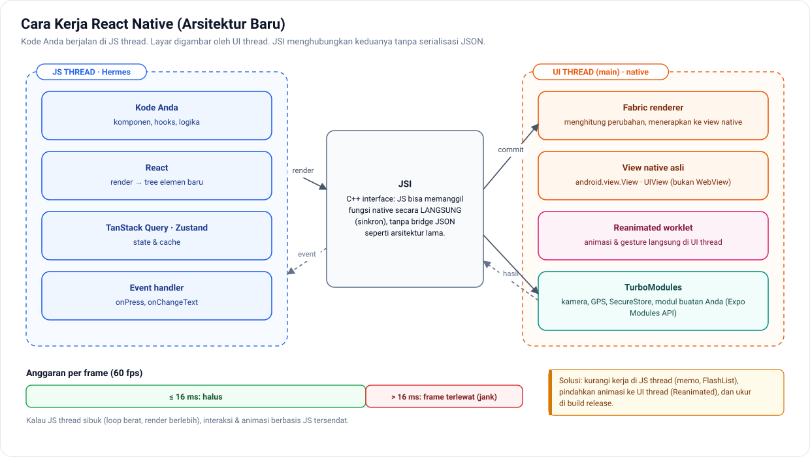
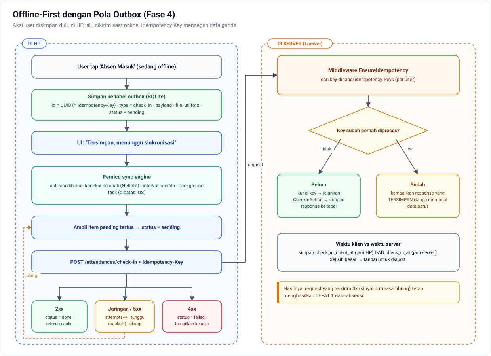

# Fase 4 — Topik Level Senior

[← Kembali ke README](../README.md) · **Durasi: 20 minggu** · Repo: `absensi-mobile`, `absensi-api`, `expo-<nama>-module`

## Tujuan Fase

Menguasai masalah-masalah yang **tidak bisa diselesaikan dengan sekadar install library**: performa, animasi halus, sinkronisasi offline, kode native, dan keamanan. Di fase ini Anda juga mulai berpikir seperti *tech lead*.

Fase ini dibagi menjadi **6 blok**:

| Blok | Topik | Minggu |
|---|---|---|
| A | Performa | 1–4 |
| B | Animasi & Gesture | 5–7 |
| C | Offline-First & Sinkronisasi | 8–11 |
| D | Native: Kotlin, Swift, Expo Modules | 12–16 |
| E | Keamanan | 17–18 |
| F | Rilis Lanjutan & Kepemimpinan Teknis | 19–20 |

---

# Blok A — Performa (Minggu 1–4)

## Minggu 1 — Cara Kerja React Native di Balik Layar

🎯 **Tujuan:** punya model mental yang benar untuk mendiagnosis performa.

📚 **Materi**
- **Thread** di RN: JS thread, UI (main) thread, dan background thread
- Kenapa UI "patah" (*jank*): frame 60/120 fps berarti ~16/8 ms per frame. Kalau JS thread sibuk, interaksi dan animasi yang bergantung pada JS tersendat.
- **Arsitektur baru** RN:
  - **JSI**: JS memanggil C++/native secara langsung, tanpa *bridge* serialisasi JSON
  - **TurboModules**: native module yang dimuat *lazy* dan bertipe
  - **Fabric**: renderer baru, mendukung fitur concurrent React
- **Hermes**: engine JS yang dioptimasi untuk mobile (bytecode precompile, startup lebih cepat)
- Sumber: [reactnative.dev: Architecture](https://reactnative.dev/architecture/landing-page) · [Performance overview](https://reactnative.dev/docs/performance)

🛠 **Latihan**
Gambar diagram (Excalidraw) alur dari "user menekan tombol" sampai "layar berubah". Tunjukkan thread mana yang terlibat di setiap tahap, lalu masukkan ke `CATATAN.md`.

## Minggu 2 — Alat Profiling

📚 **Materi**
- **React DevTools Profiler**: komponen mana yang render, berapa lama, dan kenapa ("why did this render")
- **Perf Monitor** di dev menu (FPS JS dan UI)
- **Android Studio Profiler**: CPU, memori, jaringan
- **Xcode Instruments** (jika punya Mac): Time Profiler, Allocations, Leaks
- Selalu ukur di **build release**; mode dev jauh lebih lambat

🛠 **Latihan**
Ukur dan catat **baseline** aplikasi absensi: waktu startup, FPS saat scroll riwayat, dan memori setelah membuka 20 layar. Simpan di `docs/performance-baseline.md`.

## Minggu 3 — Optimasi List & Gambar

📚 **Materi**
- **FlashList**: recycling view, `estimatedItemSize` (cek dokumentasi versi yang Anda pakai), `getItemType`
- Item list yang ringan: hindari komponen berat, hindari fungsi inline yang memicu re-render
- `expo-image`: cache disk dan memori, placeholder (blurhash), ukuran gambar sesuai tampilan
- Backend: sediakan **thumbnail** untuk foto selfie (resize di queue Laravel), jangan kirim gambar asli ke list

🛠 **Latihan**
1. Seed 10.000 riwayat absensi. Bandingkan `FlatList` vs `FlashList` (FPS, memori).
2. Buat endpoint thumbnail di Laravel dan pakai di list.

## Minggu 4 — Startup Time & Ukuran Aplikasi

📚 **Materi**
- Hal-hal yang memperlambat startup: import berat di root, inisialisasi sinkron, terlalu banyak provider
- *Lazy load* layar dan modul berat
- Analisis bundle (misalnya `npx expo export` + source-map-explorer, atau Expo Atlas)
- Ukuran APK/AAB: hapus dependensi yang tidak dipakai, kompresi aset, ABI split (AAB menangani otomatis)
- Memory leak: listener, timer, atau subscription yang tidak dibersihkan

🛠 **Latihan**
Turunkan waktu startup minimal **20%** dari baseline. Dokumentasikan sebelum-sesudah beserta apa yang Anda ubah.

✅ **Checkpoint Blok A**
- Bisa menjelaskan perbedaan JS thread dan UI thread, dan dampaknya ke animasi
- Punya laporan performa dengan angka *sebelum → sesudah*

---

# Blok B — Animasi & Gesture (Minggu 5–7)

## Minggu 5 — Reanimated Dasar

📚 **Materi**
- [Reanimated](https://docs.swmansion.com/react-native-reanimated/): animasi berjalan di **UI thread**, sehingga tetap halus walau JS sibuk
- `useSharedValue`, `useAnimatedStyle`, `withTiming`, `withSpring`, `withSequence`, `withRepeat`
- **Worklet**: fungsi kecil yang dijalankan di UI thread
- Layout animation: `entering`, `exiting`, `layout`

🛠 **Latihan**
Tombol check-in dengan animasi "pulse", kartu status yang muncul dengan animasi, dan item list yang beranimasi saat dihapus.

## Minggu 6 — Gesture Handler

📚 **Materi**
- [React Native Gesture Handler](https://docs.swmansion.com/react-native-gesture-handler/): `Gesture.Pan()`, `Tap`, `LongPress`, `Pinch`, dan komposisi gesture
- Menggabungkan gesture + Reanimated untuk interaksi 60 fps
- `scrollTo`, `interpolate`, `Extrapolation`

🛠 **Latihan**
1. **Swipe untuk aksi** di item riwayat (geser kiri → lihat detail, geser kanan → laporkan masalah).
2. **Bottom sheet** buatan sendiri (lalu bandingkan dengan `@gorhom/bottom-sheet`).

## Minggu 7 — Polishing UX

📚 **Materi**
- Skeleton loading, transisi antar-layar, haptic feedback di momen penting
- Menghormati pengaturan "Reduce Motion" (`useReducedMotion`)
- **Aksesibilitas**: `accessibilityLabel`, `accessibilityRole`, ukuran target sentuh minimal 44–48 dp, dukungan font besar, uji dengan TalkBack/VoiceOver

🛠 **Latihan**
Audit aksesibilitas aplikasi absensi dengan TalkBack. Perbaiki semua temuan.

✅ **Checkpoint Blok B**
- Animasi tetap halus saat JS thread sengaja dibuat sibuk (uji dengan loop berat)
- Aplikasi bisa dipakai sepenuhnya dengan screen reader

---

# Blok C — Offline-First & Sinkronisasi (Minggu 8–11)

> Ini salah satu topik **pembeda senior yang paling kuat**. Aplikasi absensi di lapangan sering kehilangan sinyal.

## Minggu 8 — Desain Sistem Offline

*Target akhir Blok C: outbox di HP + idempotency di server.*

📚 **Materi**
- **Offline-first**: UI selalu membaca dari **database lokal**; sinkronisasi dengan server berjalan di belakang
- Pilihan database lokal:
  - **expo-sqlite** (+ Drizzle ORM): fleksibel, SQL penuh
  - **op-sqlite**: performa tinggi (JSI)
  - **WatermelonDB**: punya protokol sync bawaan, reaktif
- Pola **Outbox**: setiap aksi user (check-in, ajukan izin) disimpan di tabel `outbox` dulu, lalu dikirim saat online
- **Idempotency key**: UUID dibuat di HP, sehingga request yang terkirim dua kali tidak membuat data ganda
- Data apa saja yang harus tersedia offline, dan mana yang boleh *online-only*

🛠 **Latihan**
Tulis **dokumen desain teknis** (`docs/design/offline-sync.md`) berisi: masalah, tujuan, opsi yang dipertimbangkan, keputusan, skema tabel lokal, diagram alur sinkronisasi, dan risiko. *Ini latihan menulis dokumen seperti seorang senior.*

## Minggu 9 — Implementasi Outbox (Mobile)

📚 **Materi**
- Tabel `outbox`: `id (uuid)`, `type`, `payload`, `status (pending|sending|failed|done)`, `attempts`, `last_error`, `created_at`
- *Sync engine*: proses antrean berurutan, retry dengan backoff, berhenti saat offline
- Pemicu sync: aplikasi dibuka, koneksi kembali (NetInfo), interval berkala, dan background task (`expo-background-task`; perhatikan batasan OS)
- Foto offline: simpan file lokal, upload saat online

🛠 **Latihan**
Check-in **tetap bisa dilakukan saat offline** dan otomatis terkirim saat online. Tampilkan status "Menunggu sinkronisasi" di UI.

## Minggu 10 — Sisi Server: Idempotency & Delta Sync

📚 **Materi (Laravel)**
- Middleware **idempotency**: header `Idempotency-Key`; kalau key sudah pernah diproses, kembalikan response yang tersimpan
- **Waktu dari klien vs waktu dari server**: absensi offline memakai waktu HP yang bisa dimanipulasi. Simpan keduanya (`client_recorded_at` dan `server_received_at`), lalu tandai kalau selisihnya mencurigakan.
- **Delta sync**: `GET /api/v1/sync?since=<timestamp>` mengembalikan data yang berubah sejak waktu tertentu, termasuk yang dihapus (soft delete)

🛠 **Latihan**
1. Middleware idempotency + test Pest (kirim request yang sama 3 kali, hasilnya hanya 1 record).
2. Endpoint delta sync untuk data jadwal shift dan status izin.

## Minggu 11 — Resolusi Konflik & Pengujian

📚 **Materi**
- Strategi konflik: *last-write-wins*, *server-wins*, *versioning* (kolom `version`/`updated_at`), dan merge per field
- Pilih strategi **per jenis data**: absensi bersifat *append-only* (jarang konflik), sedangkan profil memakai server-wins
- Menguji skenario sulit: mode pesawat, aplikasi di-kill saat sync, jam HP dimundurkan

🛠 **Latihan**
Buat **matriks pengujian offline** (minimal 10 skenario) dan pastikan semuanya lulus.

✅ **Checkpoint Blok C**
- Aplikasi bisa dipakai penuh selama 1 hari tanpa internet, lalu sinkron tanpa data ganda atau hilang
- Dokumen desain teknis selesai dan di-review (minta teman atau komunitas untuk me-review)

---

# Blok D — Native: Kotlin, Swift & Expo Modules (Minggu 12–16)

> Senior React Native tidak harus jago native, tapi **harus bisa membaca dan menulis modul kecil** saat library tidak tersedia.

## Minggu 12 — Kotlin untuk Developer JavaScript

📚 **Materi**
- Sintaks: `val`/`var`, null safety (`?`, `?.`, `?:`, `!!`), `data class`, `when`, extension function, lambda
- Coroutine dasar (`suspend`, `launch`) sebagai padanan async/await
- Struktur proyek Android: `AndroidManifest.xml`, Gradle, `Activity`, `Context`
- Sumber: [Kotlin docs](https://kotlinlang.org/docs/getting-started.html) · [Kotlin Koans](https://play.kotlinlang.org/koans)

🛠 **Latihan**
Kerjakan 20+ soal Kotlin Koans. Buka folder `android/` hasil `npx expo prebuild` dan baca strukturnya.

## Minggu 13 — Swift untuk Developer JavaScript

📚 **Materi**
- Sintaks: `let`/`var`, optional (`?`, `if let`, `guard let`), `struct` vs `class`, `enum` dengan associated value, closure
- `async`/`await` di Swift
- Struktur proyek iOS: `Info.plist`, CocoaPods, `AppDelegate`
- Sumber: [The Swift Programming Language](https://docs.swift.org/swift-book/)
- *Tanpa Mac*: belajar sintaks di [SwiftFiddle](https://swiftfiddle.com/) atau Swift di Linux

🛠 **Latihan**
Tulis ulang 5 fungsi domain (misalnya hitung jarak dan status keterlambatan) dalam Kotlin dan Swift.

## Minggu 14 — Expo Modules API: Modul Pertama

📚 **Materi**
- `npx create-expo-module@latest` untuk membuat modul lokal atau modul yang dipublikasikan
- Definisi modul: `Function`, `AsyncFunction`, `Events`, `Constants`, `View` (native view)
- Tipe dari TypeScript ke Kotlin/Swift
- Sumber: [Expo Modules API](https://docs.expo.dev/modules/overview/)

🛠 **Latihan: modul sederhana**
Modul `expo-device-integrity`:
- `isDeveloperModeEnabled()` (Android: `Settings.Global.DEVELOPMENT_SETTINGS_ENABLED`)
- `isMockLocationEnabled()`, untuk mendeteksi **fake GPS**. Ini sangat relevan untuk aplikasi absensi. (Android: `Location.isMock()` / `isFromMockProvider()`)
- `getBatteryLevel()` + event `onBatteryLow`

## Minggu 15 — Config Plugin & Native View

📚 **Materi**
- **Config plugin**: memodifikasi `AndroidManifest`, `Info.plist`, dan Gradle secara otomatis saat prebuild, tanpa mengedit folder native secara manual
- *Continuous Native Generation (CNG)*: folder `android/` dan `ios/` tidak perlu di-commit
- Native view sederhana (misalnya komponen peta atau kamera kustom)

🛠 **Latihan**
Tambahkan config plugin ke modul Anda yang otomatis menambahkan permission yang diperlukan.

## Minggu 16 — Publikasi & Integrasi

🛠 **Latihan**
1. Integrasikan modul ke aplikasi absensi: tolak check-in kalau terdeteksi mock location, dan **kirim flag ke server** untuk dicatat.
2. Tulis test untuk sisi JS modul.
3. Publikasikan ke **npm** dengan README yang baik (instalasi, API, contoh, batasan).
4. *(Tantangan opsional)* Modul **printer thermal Bluetooth** untuk mencetak bukti absensi atau struk.

✅ **Checkpoint Blok D**
- [ ] Bisa membaca kode Kotlin/Swift di native module library populer
- [ ] Punya 1 native module terpublikasi di npm
- [ ] Paham JSI, TurboModules, dan Fabric dalam level konsep

---

# Blok E — Keamanan (Minggu 17–18)

## Minggu 17 — Keamanan Aplikasi Mobile

📚 **Materi**
- Acuan: [OWASP MASVS](https://mas.owasp.org/MASVS/) dan *OWASP Mobile Top 10*
- **Prinsip utama: aplikasi mobile tidak bisa dipercaya.** Semua validasi penting dilakukan di server.
- Penyimpanan: token di SecureStore; jangan simpan data sensitif di log, AsyncStorage, atau screenshot (`FLAG_SECURE` untuk layar sensitif)
- **Jangan menaruh rahasia** (API secret, kunci admin) di bundle; bundle JS bisa diekstrak dari APK
- Transport: HTTPS wajib; **certificate pinning** (pertimbangkan trade-off-nya: sertifikat yang berganti bisa memutus aplikasi lama)
- Deteksi root/jailbreak dan emulator (sebagai sinyal tambahan, bukan satu-satunya proteksi)
- Obfuscation: Hermes bytecode + R8/ProGuard di Android

## Minggu 18 — Keamanan Backend untuk Klien Mobile

📚 **Materi**
- Token dengan masa berlaku (`expiration` di Sanctum), pencabutan token per device
- Rate limiting per user dan per IP, terutama untuk endpoint login
- Validasi geofence dan waktu **di server**; jangan percaya flag dari klien begitu saja
- Otorisasi dengan **Policy** Laravel di setiap endpoint (cegah IDOR)
- Audit log untuk aksi penting
- Opsional: Play Integrity API untuk memverifikasi bahwa request berasal dari aplikasi asli

🛠 **Latihan**
Lakukan **self-pentest** sederhana:
1. Dekompilasi APK Anda sendiri (misalnya dengan `jadx`): apa saja yang terlihat?
2. Coba kirim request check-in palsu lewat Postman dengan koordinat kantor: apakah server bisa mendeteksinya?
3. Coba akses data karyawan lain dengan mengganti ID.

Tulis laporan temuan dan perbaikannya di `docs/security-review.md`.

✅ **Checkpoint Blok E**
- Laporan security review selesai dan semua temuan kritis sudah diperbaiki

---

# Blok F — Rilis Lanjutan & Kepemimpinan Teknis (Minggu 19–20)

## Minggu 19 — Strategi Rilis Profesional

📚 **Materi**
- **Staged rollout** di Play Store (5% → 20% → 50% → 100%) sambil memantau *crash-free rate* di Sentry
- **Feature flag**: aktifkan fitur dari server tanpa rilis ulang (buat sendiri di Laravel: tabel `feature_flags`, endpoint `GET /api/v1/config`)
- **Force update / soft update**: endpoint config mengembalikan `min_version` dan `latest_version`, lalu aplikasi menampilkan dialog update
- *Semantic versioning*, `versionCode` otomatis (EAS `autoIncrement`)
- *Changelog* otomatis dari commit (*conventional commits*)
- Kebijakan deprecation API: berapa lama versi API lama didukung

🛠 **Latihan**
Implementasikan feature flag + force update. Uji: set `min_version` di atas versi terpasang, lalu aplikasi harus memaksa update.

## Minggu 20 — Kemampuan Non-Teknis Seorang Senior

📚 **Materi**
- **Menulis dokumen desain teknis** (RFC) sebelum membangun fitur besar
- **Code review** yang membangun: fokus pada kebenaran, keterbacaan, dan risiko, bukan selera pribadi
- **Estimasi** dan memecah pekerjaan besar menjadi tiket kecil
- **Komunikasi trade-off** ke non-teknis ("opsi A lebih cepat 2 minggu tapi tidak mendukung offline")
- **Mentoring**: menjelaskan konsep ke developer junior
- **Post-mortem** tanpa saling menyalahkan (*blameless*) setelah insiden

🛠 **Latihan Akhir Fase 4**
1. Tulis **post-mortem fiktif** untuk sebuah insiden ("Rilis v1.4 menyebabkan crash di Android 10").
2. Buat **presentasi 15 menit** (rekam video) yang menjelaskan arsitektur aplikasi absensi Anda: keputusan, trade-off, dan apa yang akan Anda lakukan berbeda.
3. Perbarui README kedua repo menjadi **studi kasus portofolio**: masalah → solusi → hasil (dengan angka).

✅ **Checkpoint Akhir Roadmap**
- [ ] Laporan performa dengan angka sebelum/sesudah
- [ ] Animasi dan gesture halus di UI thread, aplikasi aksesibel
- [ ] Offline-first dengan outbox + idempotency, teruji 10+ skenario
- [ ] 1 native module terpublikasi di npm
- [ ] Laporan security review
- [ ] Feature flag + force update + staged rollout
- [ ] Minimal 3 dokumen desain teknis, 8+ ADR, 1 post-mortem
- [ ] Portofolio berupa studi kasus di GitHub

---

← [Fase 3](fase-3-kualitas-arsitektur.md) · Lanjut ke → [Kebiasaan Berkelanjutan](berkelanjutan.md)
