# 🖼️ Peta Visual: Galeri Semua Diagram

[← Kembali ke README](../README.md) · [Dokumen Arsitektur](../arsitektur/00-dokumen-arsitektur.md)

Semua diagram di repo ini ada di halaman ini, dikelompokkan per topik. Klik gambar untuk melihat ukuran penuh.

> Diagram dibuat dari kode di [`tools/diagram/`](../tools/diagram/README.md). Untuk mengubahnya, edit file Python lalu jalankan ulang script-nya. Jangan edit SVG secara manual.

---

## 🗺️ Perjalanan Belajar

### Peta 18 bulan
Dipakai di: [README](../README.md)

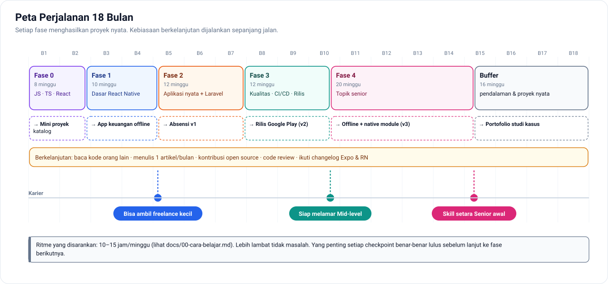

---

## 🧠 Konsep Dasar

### Event loop JavaScript (Fase 0, Minggu 3)
Kenapa `Promise.then` jalan sebelum `setTimeout(…, 0)`.

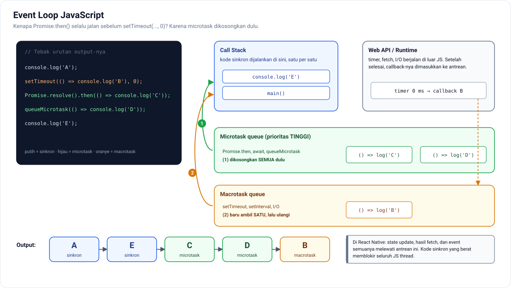

### Cara kerja React Native (Fase 1 & Fase 4)
JS thread, UI thread, JSI, Fabric, TurboModules, dan anggaran 16 ms per frame.

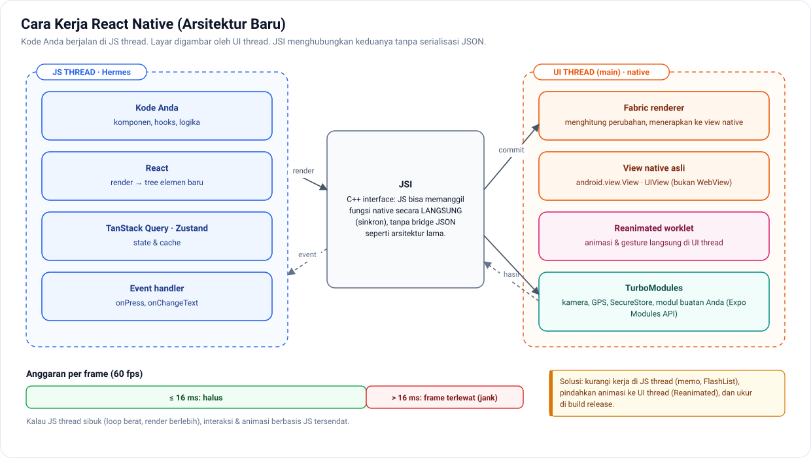

### Siklus cache TanStack Query (Fase 2, Minggu 3–4)
fresh → stale → inactive → dihapus, beserta pemicu refetch otomatis.

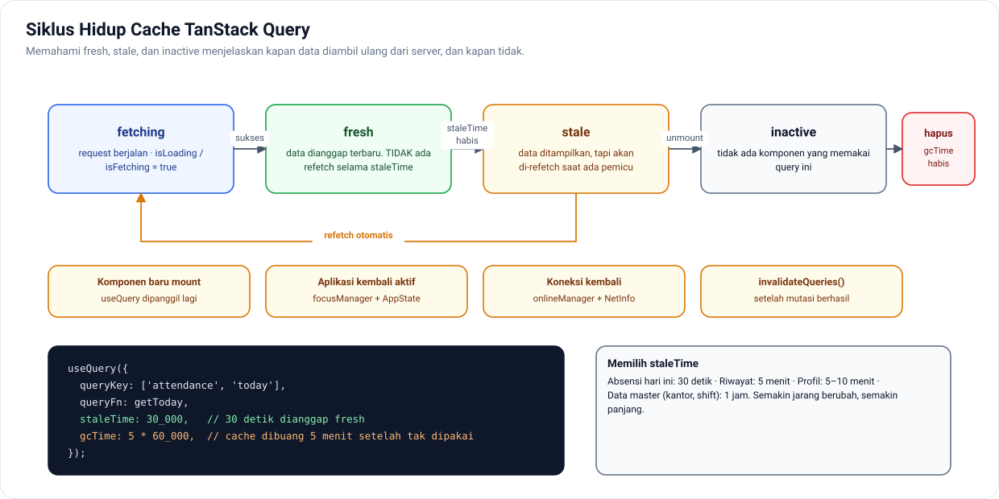

### Peta state: data disimpan di mana? (Fase 1–2)

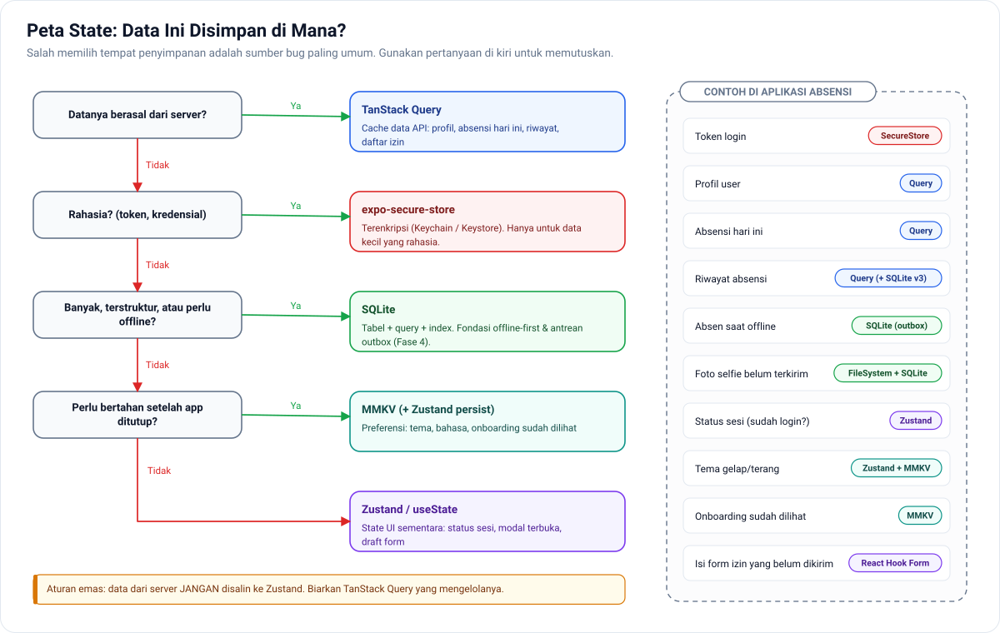

---

## 🏗️ Arsitektur

### Gambaran sistem

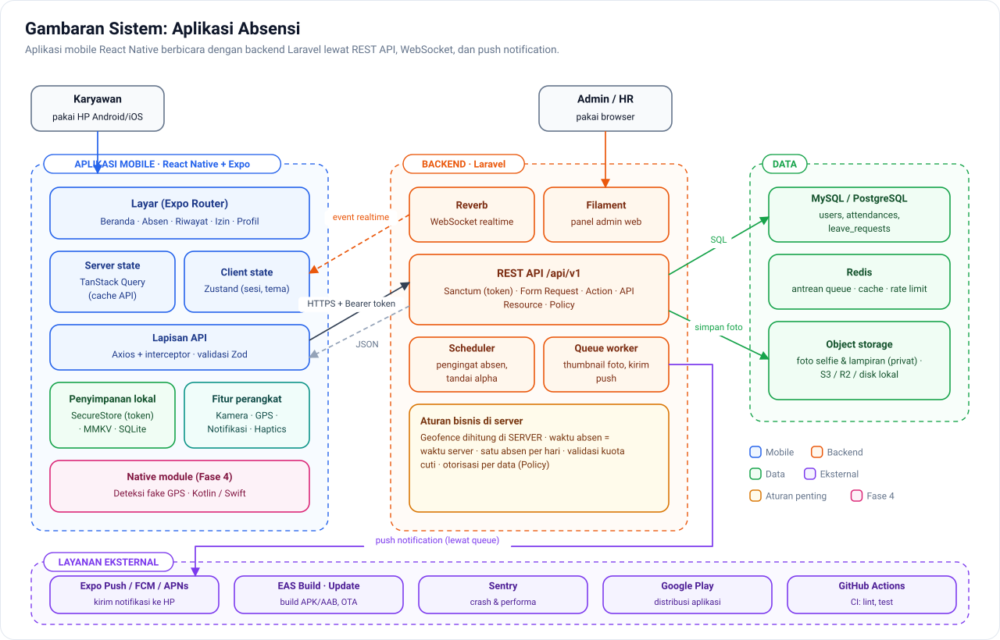

### Aplikasi mobile: berbasis fitur & berlapis (Fase 3)

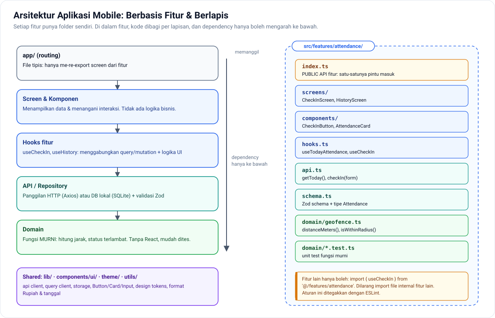

### Perjalanan satu request di Laravel (Fase 2)

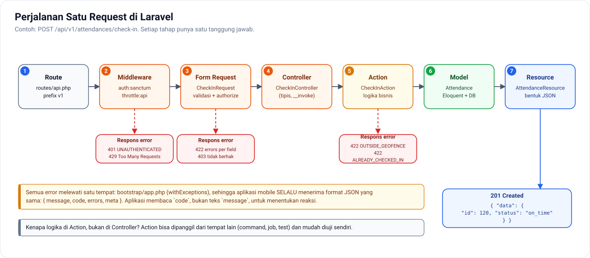

### Desain database

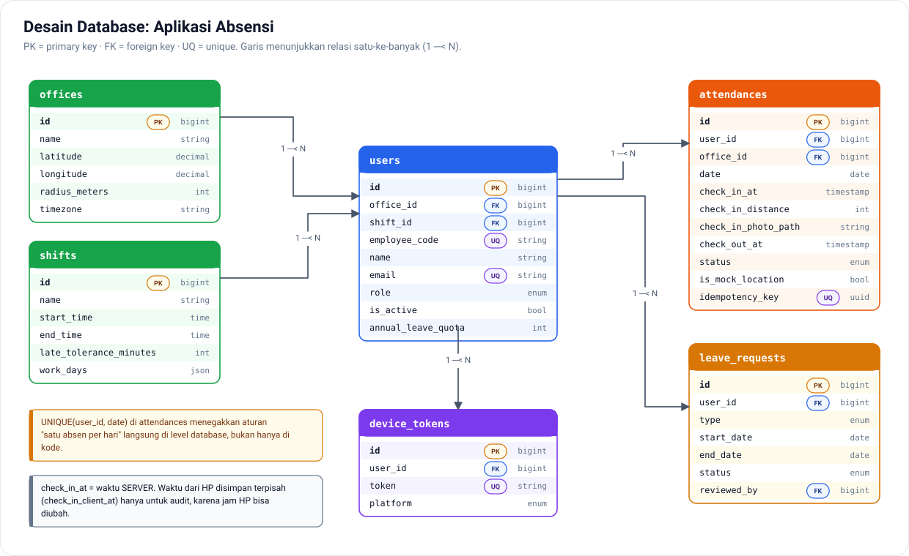

---

## 🔄 Alur

### Autentikasi (Fase 2, Minggu 2)

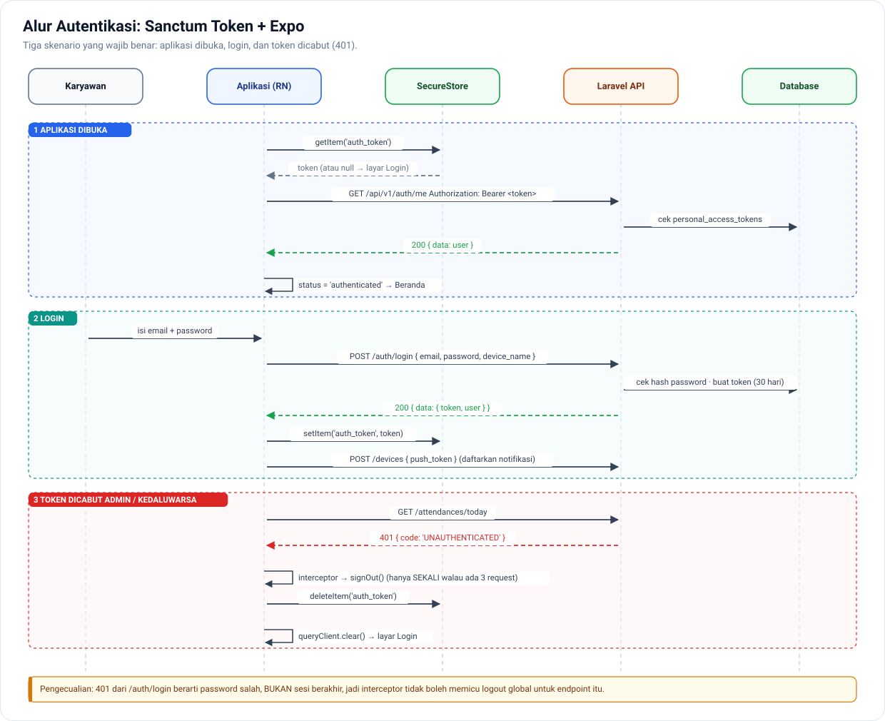

### Absen masuk end-to-end (Fase 2, Sprint 2)

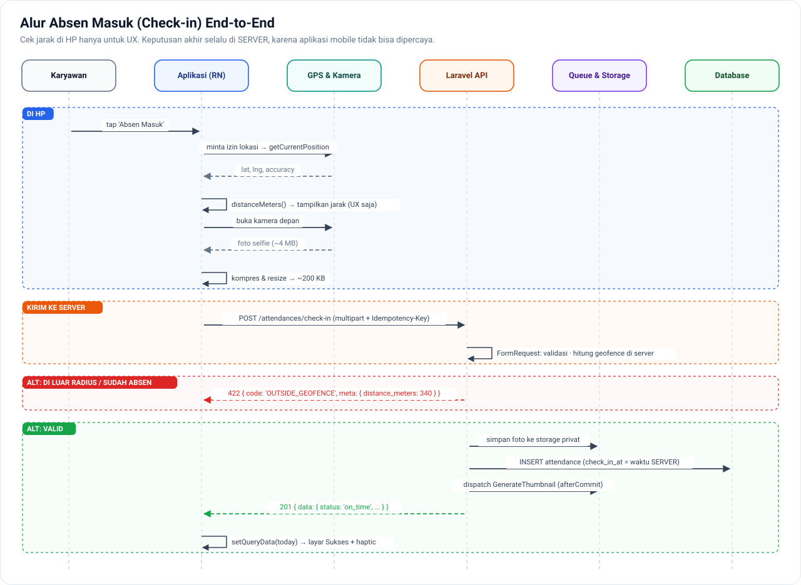

### Push notification vs realtime (Fase 2, Minggu 7–8)

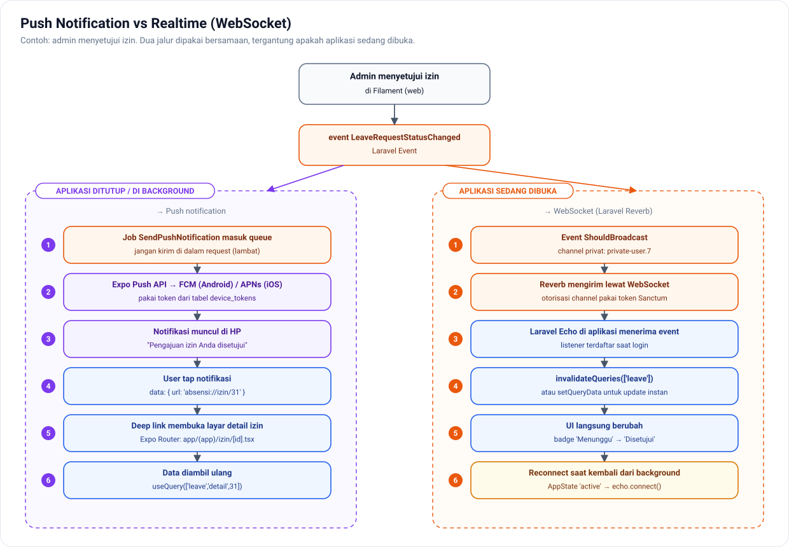

### Offline-first dengan outbox (Fase 4, Blok C)

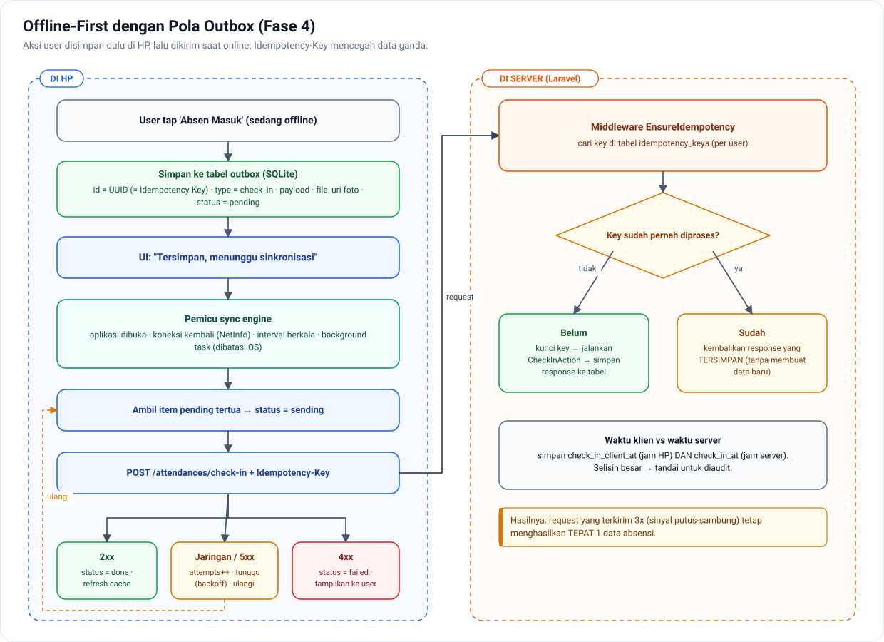

---

## ✅ Kualitas & Rilis

### Piramida testing (Fase 3, Minggu 3–6)

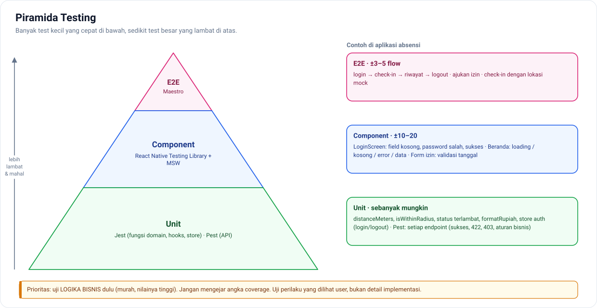

### Alur rilis CI/CD (Fase 3, Minggu 8–12)

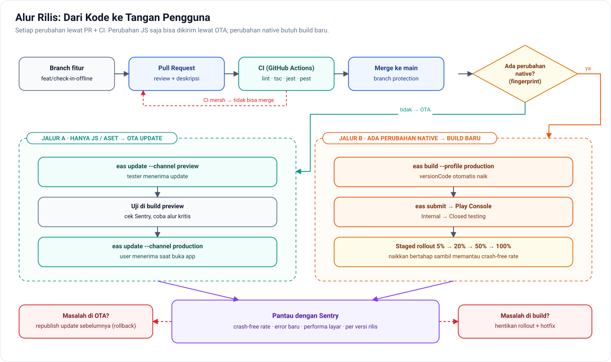

---

## 📝 Cara Belajar dari Diagram

1. **Lihat dulu, baca kemudian.** Coba pahami diagram sebelum membaca penjelasan di dokumen terkait.
2. **Jelaskan dengan suara.** Tunjuk setiap kotak dan jelaskan perannya. Kalau tersendat, di situlah celah pemahaman Anda.
3. **Gambar ulang dari ingatan** di kertas atau [Excalidraw](https://excalidraw.com/), lalu bandingkan.
4. **Cocokkan dengan kode.** Setelah membangun fitur, buka diagramnya dan tandai: "kotak ini = file mana?"
