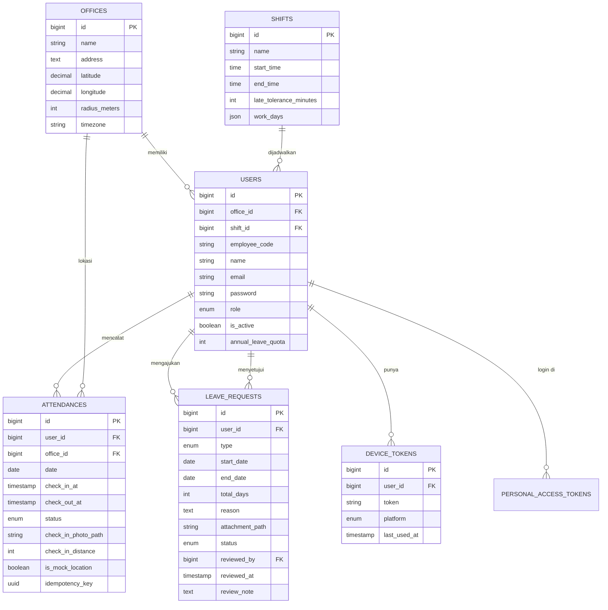

# Proyek Absensi — 02. Desain Database

[← Kembali ke README](../README.md) · [← PRD](01-prd.md)

---

## 1. ERD



---

## 2. Migrasi

### `offices`
```php
Schema::create('offices', function (Blueprint $table) {
    $table->id();
    $table->string('name');
    $table->text('address')->nullable();
    $table->decimal('latitude', 10, 7);
    $table->decimal('longitude', 10, 7);
    $table->unsignedInteger('radius_meters')->default(100);
    $table->string('timezone')->default('Asia/Jakarta');   // WIB / WITA / WIT
    $table->timestamps();
});
```

### `shifts`
```php
Schema::create('shifts', function (Blueprint $table) {
    $table->id();
    $table->string('name');                                // "Shift Pagi"
    $table->time('start_time');                            // 08:00
    $table->time('end_time');                              // 17:00
    $table->unsignedSmallInteger('late_tolerance_minutes')->default(10);
    $table->json('work_days');                             // [1,2,3,4,5] = Senin–Jumat (ISO)
    $table->timestamps();
});
```

### `users` (tambahan dari migrasi bawaan)
```php
Schema::table('users', function (Blueprint $table) {
    $table->foreignId('office_id')->nullable()->constrained()->nullOnDelete();
    $table->foreignId('shift_id')->nullable()->constrained()->nullOnDelete();
    $table->string('employee_code')->unique()->nullable();
    $table->string('phone')->nullable();
    $table->string('position')->nullable();
    $table->string('avatar_path')->nullable();
    $table->enum('role', ['employee', 'admin'])->default('employee');
    $table->boolean('is_active')->default(true);
    $table->unsignedSmallInteger('annual_leave_quota')->default(12);
});
```

### `attendances`
```php
Schema::create('attendances', function (Blueprint $table) {
    $table->id();
    $table->foreignId('user_id')->constrained()->cascadeOnDelete();
    $table->foreignId('office_id')->constrained();
    $table->date('date');

    // Masuk
    $table->timestamp('check_in_at')->nullable();          // waktu SERVER
    $table->timestamp('check_in_client_at')->nullable();   // waktu HP (audit)
    $table->decimal('check_in_latitude', 10, 7)->nullable();
    $table->decimal('check_in_longitude', 10, 7)->nullable();
    $table->decimal('check_in_accuracy', 8, 2)->nullable();
    $table->unsignedInteger('check_in_distance')->nullable();
    $table->string('check_in_photo_path')->nullable();

    // Pulang
    $table->timestamp('check_out_at')->nullable();
    $table->timestamp('check_out_client_at')->nullable();
    $table->decimal('check_out_latitude', 10, 7)->nullable();
    $table->decimal('check_out_longitude', 10, 7)->nullable();
    $table->unsignedInteger('check_out_distance')->nullable();
    $table->string('check_out_photo_path')->nullable();

    $table->string('thumbnail_path')->nullable();
    $table->enum('status', ['on_time', 'late', 'absent', 'leave'])->default('on_time');
    $table->unsignedInteger('work_duration_minutes')->nullable();
    $table->boolean('is_mock_location')->default(false);
    $table->boolean('is_offline_sync')->default(false);    // v3: dikirim dari antrean offline
    $table->uuid('idempotency_key')->nullable()->unique(); // v3
    $table->text('note')->nullable();
    $table->timestamps();

    $table->unique(['user_id', 'date']);                   // BR-01 ditegakkan di level database
    $table->index(['office_id', 'date']);                  // dashboard admin per kantor
});
```

### `leave_requests`
```php
Schema::create('leave_requests', function (Blueprint $table) {
    $table->id();
    $table->foreignId('user_id')->constrained()->cascadeOnDelete();
    $table->enum('type', ['sick', 'permit', 'annual_leave']);
    $table->date('start_date');
    $table->date('end_date');
    $table->unsignedSmallInteger('total_days');            // hari kerja saja
    $table->text('reason');
    $table->string('attachment_path')->nullable();
    $table->enum('status', ['pending', 'approved', 'rejected', 'cancelled'])->default('pending');
    $table->foreignId('reviewed_by')->nullable()->constrained('users')->nullOnDelete();
    $table->timestamp('reviewed_at')->nullable();
    $table->text('review_note')->nullable();
    $table->timestamps();

    $table->index(['user_id', 'status']);
    $table->index(['start_date', 'end_date']);
});
```

### `device_tokens`
```php
Schema::create('device_tokens', function (Blueprint $table) {
    $table->id();
    $table->foreignId('user_id')->constrained()->cascadeOnDelete();
    $table->string('token')->unique();                     // Expo push token / FCM token
    $table->enum('platform', ['android', 'ios']);
    $table->string('device_name')->nullable();
    $table->string('app_version')->nullable();
    $table->timestamp('last_used_at')->nullable();
    $table->timestamps();
});
```

### v3 (Fase 4): `idempotency_keys`
```php
Schema::create('idempotency_keys', function (Blueprint $table) {
    $table->uuid('key')->primary();
    $table->foreignId('user_id')->constrained()->cascadeOnDelete();
    $table->string('route');
    $table->string('request_hash', 64);                    // sha256 isi request
    $table->unsignedSmallInteger('response_status')->nullable();
    $table->json('response_body')->nullable();
    $table->timestamp('locked_until')->nullable();         // sedang diproses → 409
    $table->timestamps();
});
```

---

## 3. Enum PHP

```php
// app/Enums/AttendanceStatus.php
enum AttendanceStatus: string
{
    case OnTime = 'on_time';
    case Late = 'late';
    case Absent = 'absent';
    case Leave = 'leave';

    public function label(): string
    {
        return match ($this) {
            self::OnTime => 'Tepat Waktu',
            self::Late => 'Terlambat',
            self::Absent => 'Alpha',
            self::Leave => 'Izin/Cuti',
        };
    }
}
```

Cast di model: `protected function casts(): array { return ['status' => AttendanceStatus::class, 'date' => 'date', ...]; }`

---

## 4. Seeder untuk Development & E2E

| Data | Isi |
|---|---|
| Kantor | 2 kantor: "Kantor Pusat Jakarta" (Monas, radius 100 m), "Cabang Bandung" |
| Shift | Pagi (08:00–17:00), Siang (13:00–21:00) |
| Admin | `admin@demo.test` / `password` |
| Karyawan | `karyawan@demo.test` / `password` + 20 karyawan acak |
| Absensi | 3 bulan data acak (campuran tepat waktu, terlambat, alpha) |
| Izin | Contoh pending, approved, rejected |

> Akun demo ini juga dipakai untuk **reviewer Google Play** dan **test E2E Maestro**.

---

## 5. Skema Lokal di HP (v3, Fase 4)

```sql
-- Cache data dari server (dibaca UI saat offline)
CREATE TABLE attendances (
  id INTEGER PRIMARY KEY,
  date TEXT NOT NULL UNIQUE,
  check_in_at TEXT,
  check_out_at TEXT,
  status TEXT NOT NULL,
  thumbnail_url TEXT,
  synced_at TEXT NOT NULL
);

-- Antrean aksi yang belum terkirim
CREATE TABLE outbox (
  id TEXT PRIMARY KEY,              -- UUID = Idempotency-Key
  type TEXT NOT NULL,               -- 'check_in' | 'check_out' | 'leave_request'
  payload TEXT NOT NULL,            -- JSON
  file_uri TEXT,                    -- foto lokal
  status TEXT NOT NULL DEFAULT 'pending',  -- pending | sending | failed | done
  attempts INTEGER NOT NULL DEFAULT 0,
  last_error TEXT,
  created_at TEXT NOT NULL
);
CREATE INDEX idx_outbox_status ON outbox(status, created_at);
```

---

[← PRD](01-prd.md) · [Lanjut → Spesifikasi API](03-api-spec.md)
