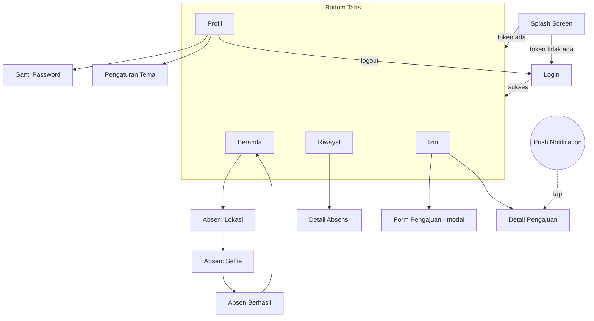
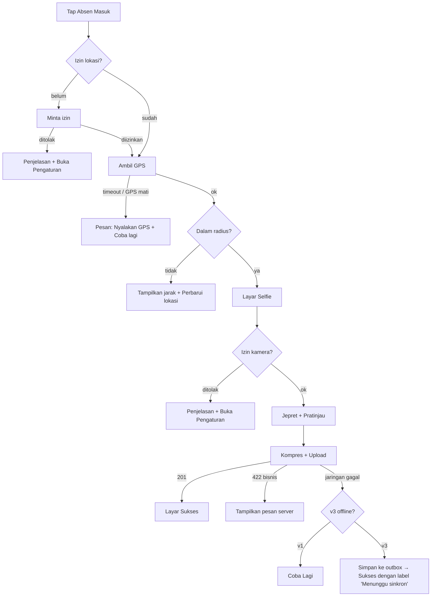

# Proyek Absensi — 04. Layar & Alur Pengguna

[← Kembali ke README](../README.md) · [← API Spec](03-api-spec.md)

---

## 1. Peta Navigasi



### Struktur `app/` (Expo Router)

```
app/
├── _layout.tsx
├── (auth)/
│   ├── _layout.tsx
│   └── login.tsx
└── (app)/
    ├── _layout.tsx                ← Stack
    ├── (tabs)/
    │   ├── _layout.tsx            ← Tabs
    │   ├── index.tsx              ← Beranda
    │   ├── riwayat.tsx
    │   ├── izin.tsx
    │   └── profil.tsx
    ├── absen/
    │   ├── lokasi.tsx             ← ?type=check_in|check_out
    │   ├── selfie.tsx
    │   └── sukses.tsx
    ├── riwayat/[id].tsx
    ├── izin/
    │   ├── [id].tsx
    │   └── baru.tsx               ← presentation: 'modal'
    ├── ganti-password.tsx
    └── pengaturan.tsx
```

Deep link: `absensi://izin/31` membuka detail pengajuan nomor 31.

---

## 2. Spesifikasi Layar

### 2.1 Login
| Elemen | Detail |
|---|---|
| Konten | Logo, input email, input password (tombol lihat/sembunyikan), tombol **Masuk** |
| Validasi klien | Email valid, password minimal 1 karakter |
| State | Tombol loading saat request; error di bawah field (422) atau di atas tombol (401/offline) |
| UX | `keyboardType="email-address"`, `autoComplete`, tekan "Next" untuk pindah ke password, tekan "Go" untuk submit |
| `testID` | `input-email`, `input-password`, `button-login` |

### 2.2 Beranda
```
┌─────────────────────────────────┐
│ Selamat pagi, Rina 👋            │
│ Kamis, 5 November 2026           │
├─────────────────────────────────┤
│ 🏢 Kantor Pusat Jakarta          │
│ ⏰ Shift Pagi · 08:00 – 17:00    │
├─────────────────────────────────┤
│        ┌───────────────┐         │
│        │  ABSEN MASUK  │         │  ← tombol besar (pulse animation di v3)
│        └───────────────┘         │
│     Masuk: --:--  Pulang: --:--  │
├─────────────────────────────────┤
│ November 2026                    │
│ Hadir 18 · Telat 3 · Izin 2 · 1  │
└─────────────────────────────────┘
```
| State | Tampilan |
|---|---|
| Belum absen | Tombol **Absen Masuk** |
| Sudah masuk | Jam masuk + badge status + tombol **Absen Pulang** |
| Sudah pulang | Jam masuk/pulang + durasi kerja, tombol nonaktif |
| Hari libur | "Hari ini libur 🎉" |
| Sedang cuti | "Anda sedang cuti sampai 21 Nov" |
| Loading | Skeleton |
| Error/offline | Data cache + banner "Offline · data terakhir 07:45" |

Pull-to-refresh tersedia.

### 2.3 Absen: Lokasi
1. Minta izin lokasi (kalau belum). Kalau ditolak, tampilkan penjelasan + tombol "Buka Pengaturan".
2. Ambil posisi (`Accuracy.High`, timeout 15 detik).
3. Tampilkan:
   - Peta kecil (opsional: `react-native-maps`) dengan titik user dan lingkaran radius kantor
   - "Jarak Anda: **23 m** dari kantor (maks. 100 m)" ✅ / ❌
   - Akurasi GPS ("±12 m")
4. Tombol **Lanjut ke Selfie** (nonaktif kalau jelas di luar radius) dan **Perbarui Lokasi**.

> Cek jarak di HP hanya untuk **UX**. Server tetap memvalidasi ulang.

### 2.4 Absen: Selfie
- Kamera depan full screen, dengan bingkai oval sebagai panduan wajah
- Tombol jepret → pratinjau → **Ulangi** / **Kirim**
- Saat kirim: kompres (lebar 720 px, kualitas 0.6) → upload dengan progress bar
- Gagal karena jaringan: tombol **Coba Lagi** (foto tidak hilang). Di v3: "Disimpan, akan dikirim otomatis saat online".
- Gagal karena bisnis (`OUTSIDE_GEOFENCE`, dan lain-lain): tampilkan `message` dari server

### 2.5 Absen Berhasil
- Animasi centang, jam absen besar, status (Tepat Waktu / Terlambat 12 menit)
- Haptic feedback sukses
- Tombol **Kembali ke Beranda** (memakai `router.replace` supaya tombol back tidak kembali ke kamera)

### 2.6 Riwayat
- Pemilih bulan di atas (‹ November 2026 ›)
- List per hari: tanggal, jam masuk–pulang, badge status, thumbnail selfie
- Infinite scroll, pull-to-refresh, state kosong ("Belum ada data absensi di bulan ini")
- v3: FlashList, swipe untuk aksi

### 2.7 Detail Absensi
Foto masuk & pulang (bisa diperbesar), jam, durasi kerja, jarak, status, catatan.

### 2.8 Izin
- Kartu kuota cuti: "Sisa cuti: **6** dari 12 hari"
- Tab filter: Semua · Menunggu · Disetujui · Ditolak
- List pengajuan dengan badge warna status
- FAB **+ Ajukan**

### 2.9 Form Pengajuan (Modal)
| Field | Komponen |
|---|---|
| Jenis | Segmented control: Sakit / Izin / Cuti |
| Tanggal mulai & selesai | Date picker; tampilkan "Total: 2 hari kerja" |
| Alasan | Text area (10–500 karakter, dengan penghitung) |
| Lampiran | Kamera/galeri (wajib untuk sakit > 1 hari) |

Validasi Zod di klien (meniru aturan server) + tampilkan error 422 dari server. Optimistic update ke list setelah submit.

### 2.10 Detail Pengajuan
Semua data + timeline status (Diajukan → Disetujui oleh HR, 6 Nov 09:12) + catatan reviewer. Tombol **Batalkan** hanya muncul jika `pending`.

### 2.11 Profil
Avatar, nama, kode karyawan, jabatan, kantor, shift · Menu: Ganti Password, Pengaturan, Tentang Aplikasi (versi) · Tombol **Keluar** (dengan konfirmasi).

---

## 3. Alur Kritis: Absen Masuk (Detail)



---

## 4. Design Tokens (Awal)

```ts
// src/theme/tokens.ts
export const palette = {
  primary: '#2563EB',
  success: '#16A34A',
  warning: '#D97706',
  danger: '#DC2626',
};

export const light = {
  background: '#FFFFFF',
  surface: '#F8FAFC',
  text: '#0F172A',
  textMuted: '#64748B',
  border: '#E2E8F0',
  ...palette,
};

export const dark = {
  background: '#0B1120',
  surface: '#111827',
  text: '#F1F5F9',
  textMuted: '#94A3B8',
  border: '#1F2937',
  ...palette,
};

export const spacing = { xs: 4, sm: 8, md: 12, lg: 16, xl: 24, xxl: 32 } as const;
export const radius = { sm: 6, md: 10, lg: 16, full: 999 } as const;
export const fontSize = { sm: 13, md: 15, lg: 17, xl: 22, xxl: 28 } as const;
```

Warna status: **Tepat Waktu** = success · **Terlambat** = warning · **Alpha** = danger · **Izin/Cuti** = primary

---

[← API Spec](03-api-spec.md) · [Lanjut → Milestone](05-milestone.md)
